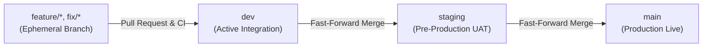

# Contributing to Al-Birru School Information System

Thank you for your interest in contributing to the **Al-Birru School Information System (`albirru-sis`)**. This project operates under rigorous engineering standards to ensure high reliability, accessibility, and relational integrity.

Please review this document thoroughly before opening an issue or submitting a pull request.

---

## 1. Code of Conduct

All contributors, maintainers, and autonomous agents are expected to adhere to our [Code of Conduct](CODE_OF_CONDUCT.md). Harassment, abusive behavior, or unprofessional conduct will not be tolerated.

---

## 2. Branch Governance & Git Workflow

Our git workflow uses strict branch hierarchy with linear history:



1. **`main`**: Production branch. Deployments are triggered automatically upon release tags or verified merges. Direct commits to `main` are strictly prohibited.
2. **`staging`**: Pre-production integration branch used for statutory testing, load testing, and client sign-off.
3. **`dev`**: Active integration branch where all feature and bugfix pull requests land.
4. **`feature/*` / `fix/*`**: Ephemeral branches created from `dev` and rebased linearly before opening a pull request.

---

## 3. Conventional Commits 1.0.0 Specification

Every commit message is validated by `@commitlint/cli` and must strictly adhere to the [Conventional Commits 1.0.0 specification](https://www.conventionalcommits.org/):

```plain text
<type>(<scope>): <subject>
```

### 3.1 Allowed Types
- `feat`: A new user-facing feature or domain capability.
- `fix`: A bug fix for an existing feature.
- `chore`: Changes to build tasks, package updates, or auxiliary tools.
- `docs`: Documentation updates or additions.
- `style`: Formatting or whitespace changes that do not affect code logic.
- `refactor`: Code refactoring that neither fixes a bug nor adds a feature.
- `perf`: A code change that improves performance or bundle size.
- `test`: Adding missing unit, integration, or E2E tests.
- `build`: Changes that affect the build system or external dependencies.
- `ci`: Changes to CI configuration files and scripts.
- `revert`: Reverting a previous commit.

### 3.2 Commit Subject Rules
- Must be written in lowercase imperative mood (e.g. `feat(admissions): implement turnstile bot verification`).
- No trailing periods.
- Subject must not exceed 72 characters.
- Non-compliant subjects (e.g. `wip`, `update`, `fixed issue`) are automatically rejected by the `commit-msg` hook.

---

## 4. Local Development Environment

### 4.1 Prerequisites
- **Node.js**: v20 or v22 LTS (Node 24 supported)
- **Package Manager**: `pnpm` (v12+)
- **PostgreSQL**: Neon Serverless PostgreSQL or local PostgreSQL instance (v16+)

### 4.2 Installation & Setup
```bash
# Clone the repository
git clone https://github.com/Mafrilearth/albirru-school-management-monorepo.git
cd albirru-school-management-monorepo

# Install dependencies
pnpm install

# Configure environment variables
cp .env.example .env.local

# Run all workspaces in development mode
pnpm run dev
```

### 4.3 Workspace Ports
| Workspace | Description | Port |
| :--- | :--- | :--- |
| `apps/app` | Authenticated SIS Portal | `http://localhost:3000` |
| `apps/web` | Public Institutional Website | `http://localhost:3001` |
| `apps/api` | Edge API & Webhook Ingress | `http://localhost:3002` |
| `apps/email` | Transactional Email Previewer | `http://localhost:3003` |
| `apps/docs` | Technical & Statutory Docs | `http://localhost:3004` |
| `apps/studio` | Drizzle Kit Studio Console | `http://localhost:3005` |
| `apps/storybook` | Design System Storybook | `http://localhost:6006` |

---

## 5. Automated Quality Gates & Git Hooks

The repository uses **Husky** and **lint-staged** to ensure that broken code is never committed or pushed:

1. **`pre-commit`**: Executes `biome check --write` on staged files. Formats code and checks for lint errors.
2. **`commit-msg`**: Validates the commit message against Conventional Commits via Commitlint.
3. **`pre-push`**: Executes `pnpm run check-types` (`turbo run check-types`). Broken TypeScript types will abort the push.

---

## 6. Pull Request Checklist (Definition of Done)

Before submitting a Pull Request, verify that your branch satisfies all criteria:

- [ ] `pnpm run check` exits with code 0 (0 Biome errors).
- [ ] `pnpm run check-types` exits with code 0 across all 10 workspaces.
- [ ] `pnpm run test` passes 100% of Vitest assertions.
- [ ] `pnpm run build` succeeds across all workspaces.
- [ ] No raw hexadecimal color codes in TSX/JSX (use semantic CSS variables).
- [ ] Database mutations return standard `ActionResponse<T>` envelopes.
- [ ] Primary keys use `uuidv7()`.
- [ ] No SQL `DELETE` queries introduced (use soft deletion with `is_active`).
- [ ] Commit history is rebased linearly against `origin/dev`.
