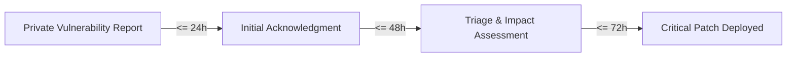
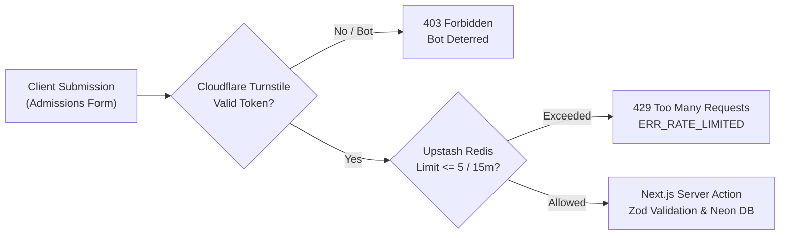

# Security Policy

The security of student, guardian, educator, and institutional data within the **Al-Birru School Information System (`albirru-sis`)** is of paramount importance. This document outlines our vulnerability disclosure process, threat mitigations, and compliance standards.

---

## 1. Supported Versions

Only the latest active versions deployed to the production environment receive security patches:

| Version / Branch | Supported | Maintenance Status |
| :--- | :---: | :--- |
| `main` (Latest Production) | Yes | Actively patched |
| `staging` (Pre-production) | Yes | Staging security validation |
| `dev` (Development) | Yes | Active vulnerability screening |
| `< 0.1.0` (Legacy / Forks) | No | Unsupported |

---

## 2. Reporting a Vulnerability

If you discover a security vulnerability within this repository, **do not open a public GitHub issue**. Publicly disclosing security flaws exposes student and administrative records to risk.

### 2.1 Private Reporting Channels
1. **GitHub Private Vulnerability Reporting**: Submit a private advisory directly through GitHub via the **Security** tab -> **Report a vulnerability**.
2. **Security Contact**: Email our engineering lead directly at `security@albirru.sch.id` (or repository administrator) with:
   - Detailed description of the vulnerability.
   - Proof of Concept (PoC) or reproducible steps.
   - Potential impact assessment.
   - Any suggested mitigations.

### 2.2 Response SLA

- **Initial Acknowledgment**: Within 24 hours.
- **Triage & Impact Assessment**: Within 48 hours.
- **Remediation & Patch Deployment**: Critical severity within 72 hours; High/Medium within 7 business days.

---

## 3. Threat Model & Built-in Security Controls

### 3.1 Authentication & Session Integrity
- **Clerk Authentication**: Managed enterprise identity provider handling secure session cookie tokens, TLS termination, multi-factor authentication, and JWT signing key rotation.
- **Role-Based Access Control (RBAC)**: Centralized authorization matrix enforcing least-privilege access across Administrator, Teacher, Staff, and Guardian personas.
- **Server Component Verification**: Route authorization is enforced server-side before any UI markup or payload is streamed to the browser.

### 3.2 Public Mutation Hardening & Anti-Abuse

- **Cloudflare Turnstile**: Public admissions registrations require valid interactive Turnstile CAPTCHA tokens, preventing scripted automated submissions.
- **Distributed Edge Rate Limiting**: Protected by `@upstash/ratelimit` over Upstash Redis REST. Form submissions are strictly throttled to 5 requests per 15-minute sliding window per IP. Exceeded limits return HTTP 429 (`ERR_RATE_LIMITED`).

### 3.3 Data Layer & Injection Mitigation
- **Zero Raw SQL String Concatenation**: All database operations use **Drizzle ORM** parameterized query builders, eliminating SQL injection vectors.
- **Zero Physical Deletion**: Operational tables utilize soft deletion (`is_active = false`) and foreign key restrictions (`onDelete: "restrict"`) to protect against accidental data destruction or cascading deletions.
- **Immutable Audit Columns**: Mandatory `created_at`, `updated_at`, and `created_by` columns maintain accountability for all modifications.

### 3.4 HTTP Hardening & Network Security
Production web applications enforce standard HTTP response headers:
- `X-Frame-Options: SAMEORIGIN` (Mitigates clickjacking)
- `X-Content-Type-Options: nosniff` (Prevents MIME-type confusion attacks)
- `Referrer-Policy: strict-origin-when-cross-origin` (Protects sensitive path leaking)
- `Permissions-Policy: camera=(), microphone=(), geolocation=()` (Restricts device sensor abuse)
- `poweredByHeader: false` (Suppresses server framework fingerprinting)

### 3.5 Secrets Management
- Production credentials (`DATABASE_URL`, `CLERK_SECRET_KEY`, `UPSTASH_REDIS_REST_TOKEN`, `RESEND_API_KEY`) are managed strictly through encrypted cloud environment variables (Vercel).
- Never commit `.env` or `.env.local` files to source control. Staged files are audited automatically before commit.
