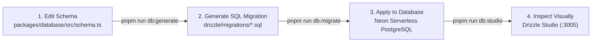

# Relational Database Architecture & Invariants

This document outlines the data model, relational architecture, and engineering invariants governing the **Al-Birru School Information System (`@albirru/database`)**.

---

## 1. Engine & ORM Specifications

- **Database Engine**: Neon Serverless PostgreSQL (Version 16+)
- **Connection Driver**: `postgres` (porsager/postgres v3)
- **Object Relational Mapper**: Drizzle ORM (`drizzle-orm` v0.45+)
- **Migration Engine**: Drizzle Kit (`drizzle-kit` v0.31+)
- **Connection Pooling**: Transaction Mode Pooling (`sslmode=require`)

---

## 2. Hard Database Invariants

Every table and query within `packages/database/src/schema.ts` must adhere to these non-negotiable invariants:

### 2.1 RFC 9562 UUIDv7 Primary Keys
All table primary keys (`id`) must utilize monotonically ordered UUIDv7:
```typescript
import { uuid } from "drizzle-orm/pg-core";
import { uuidv7 } from "uuidv7";

id: uuid("id").primaryKey().$defaultFn(() => uuidv7())
```
*Rationale*: UUIDv7 embeds a millisecond-precision Unix timestamp in the high bits, preventing B-tree index fragmentation and eliminating sequential enumeration vulnerabilities (IDOR).

### 2.2 Mandatory Audit Columns
Every operational entity must include:
- `created_at`: `timestamp("created_at", { withTimezone: true }).defaultNow().notNull()`
- `updated_at`: `timestamp("updated_at", { withTimezone: true }).defaultNow().notNull()`
- `created_by`: `uuid("created_by").references(() => users.id)` *(Nullable only on public self-registration endpoints)*

### 2.3 Zero Physical Deletion (Soft Deletion Only)
Executing SQL `DELETE` is strictly prohibited. Deactivation of records is achieved via:
- `is_active`: `boolean("is_active").default(true).notNull()`

### 2.4 Supporting B-Tree Indexes
Every foreign key column (`*_id`) must be indexed to ensure join performance and prevent full-table sequential scans.

---

## 3. Database Migration Workflow

Never execute raw, unmanaged SQL DDL commands in production. All schema evolution must follow the deterministic Drizzle Kit migration workflow:



```bash
# 1. Modify schema declarations in packages/database/src/schema.ts

# 2. Generate deterministic SQL migration files
pnpm run db:generate

# 3. Apply migrations to the target database
pnpm run db:migrate

# 4. Inspect tables visually using Drizzle Studio
pnpm run db:studio
```
