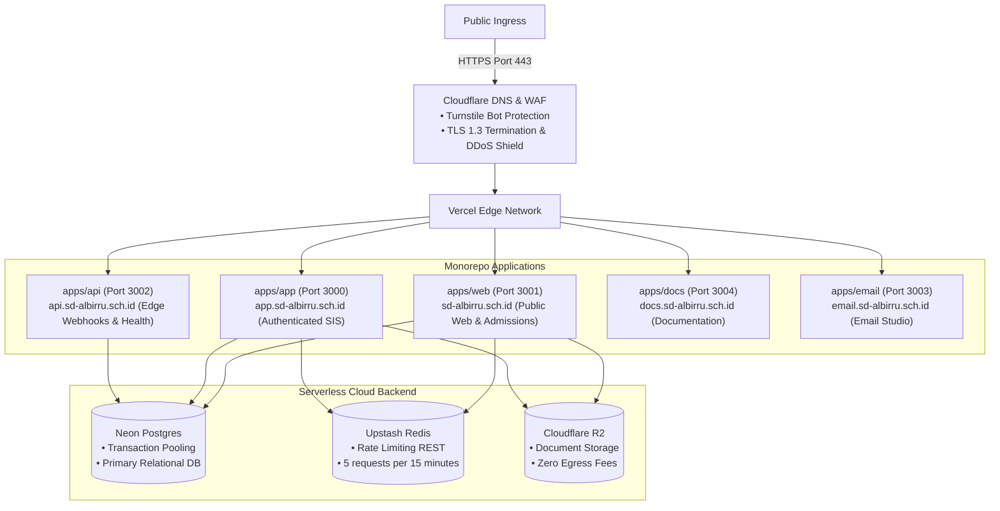
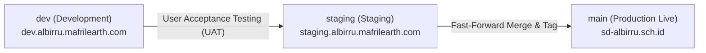

# Deployment & Infrastructure Runbook

This document specifies the authoritative deployment procedures, cloud infrastructure topology, and environment configuration for the **Al-Birru School Information System (`albirru-sis`)**.

---

## 1. Cloud Infrastructure Architecture

The platform operates on a zero-maintenance, serverless edge architecture:



---

## 2. Environments & Git Branch Mapping

| Environment | Git Branch | Canonical URL | Automated Trigger |
| :--- | :--- | :--- | :--- |
| **Production** | `main` | `https://sd-albirru.sch.id` | Pull Request Merge to `main` |
| **Staging** | `staging` | `https://staging.albirru.mafrilearth.com` | Pull Request Merge to `staging` |
| **Development** | `dev` | `https://dev.albirru.mafrilearth.com` | Pull Request Merge to `dev` |



---

## 3. Pre-Deployment Verification Checklist

Before promoting any branch to `staging` or `main`, execute the full quality verification suite:

```bash
# 1. Verify code formatting and linting
pnpm run check

# 2. Verify TypeScript strict type consistency (across all 10 packages)
pnpm run check-types

# 3. Execute unit and integration tests
pnpm run test

# 4. Verify complete production build
pnpm run build
```

---

## 4. Continuous Integration & Quality Gates (`.github/workflows/ci.yml`)

GitHub Actions automatically runs four parallel quality gates on every Pull Request:
1. **Lint & Formatting**: `biome check .`
2. **Type Checking**: `turbo run check-types`
3. **Automated Unit Tests**: `turbo run test`
4. **Monorepo Build**: `turbo run build`

Pull Requests cannot be merged if any quality gate fails.

---

## 5. Rollback & Disaster Recovery Runbook

If a critical incident or runtime defect occurs in Production:

1. **Instant Vercel Instant Rollback**:
   - Access the Vercel Dashboard -> Project -> **Deployments**.
   - Select the previous stable deployment hash and click **Instant Rollback**.
   - Traffic is redirected to the healthy build within <5 seconds.
2. **Database Point-in-Time Restore (PITR)**:
   - Neon PostgreSQL maintains continuous WAL archiving.
   - To restore state prior to a corrupted migration, navigate to Neon Console -> **Branches** -> create a restore branch from the exact timestamp.
