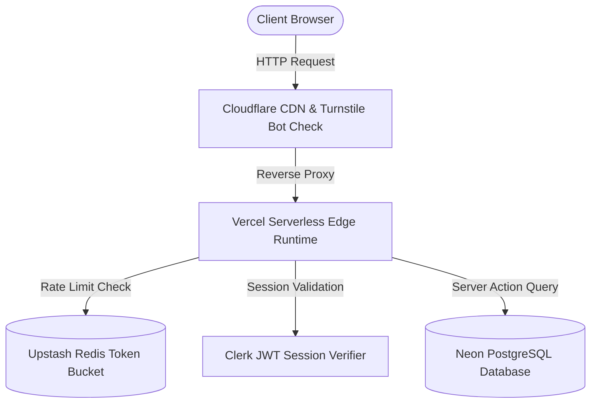

# Al-Birru School Information System (albirru-sis)
# Technical Design Document (TDD) & Design System Specification

**Document Status:** Approved & Authoritative  
**Standard Compliance:** W3C WCAG 2.1 AA, RFC 9562 (UUIDv7), Conventional Design Doc Standard  
**System Scope:** Institutional Public Web (`apps/web`), Authenticated SIS Portal (`apps/app`), Edge API (`apps/api`), Email Studio (`apps/email`), Docs (`apps/docs`), Database (`packages/database`), and Design System (`packages/design-system`).

---

## 1. Executive Summary & Problem Statement

### 1.1 Context
Primary Islamic education institutions require integrated operational management spanning student admissions, daily multi-session attendance, weighted academic grading, guardian reporting, and institutional branding. Traditional school software is fragmented across paid external CMS platforms, rigid legacy monoliths, or disjointed spreadsheets.

### 1.2 Goals
1. **Unified Modular Monolith**: Consolidate institutional public web and administrative SIS operations under a unified Next.js 16 monorepo with zero external paid CMS runtime dependencies.
2. **Sub-15ms Edge Configuration & Sub-200ms Mutation Budget**: Serve static public pages instantaneously via Edge CDN, dynamic configurations via Vercel Edge Config (<15ms), and server mutations within p95 latency budgets (<200ms).
3. **Accessibility & Design Consistency**: Achieve 100% W3C WCAG 2.1 AA accessibility (>= 4.5:1 text contrast) using unstyled headless primitives (`@base-ui/react`, `@shadcn/react`) and CSS variable semantic tokens.
4. **Relational & Audit Integrity**: Guarantee complete transactional integrity with PostgreSQL, Drizzle ORM, time-sortable UUIDv7 primary keys, and zero physical deletion.

### 1.3 Non-Goals
- Third-party paid CMS hosting (Sanity, Strapi, Contentful).
- Custom unvetted cryptographic implementations (delegate strictly to Web Crypto API & Clerk IAM).
- Client-side direct database queries or unvalidated public mutation endpoints.

---

## 2. Visual Design System & Spatial Architecture

The visual presentation adheres to strict mathematical proportions to establish trust, calm, and institutional authority for parents, educators, and regulatory inspectors.

### 2.1 8px Geometric Spatial Scale
All padding, margin, gap, and dimension definitions must snap to multiples of 8px (with 4px reserved exclusively for micro-adjustments):

| Token | Dimension | Use Case |
| :--- | :--- | :--- |
| `space-1` | 4px | Micro padding, dense badge offsets, icon gaps |
| `space-2` | 8px | Input interior padding, button icon gap, tight card margins |
| `space-3` | 12px | Compact component vertical padding |
| `space-4` | 16px | Standard button padding, stack gap, table cell padding |
| `space-6` | 24px | Card content padding, form section gap |
| `space-8` | 32px | Page header margin, modal container padding |
| `space-12` | 48px | Grid gap between major dashboard widgets |
| `space-16` | 64px | Section padding on public landing pages |
| `space-24` | 96px | Hero banner top/bottom container padding |

### 2.2 Typography: Major Third Scale (Ratio 1.250)
Typography utilizes the Major Third modular scale to maintain hierarchy without visual clutter:

| Level | Size | Line Height | Tracking | Semantic Usage |
| :--- | :--- | :--- | :--- | :--- |
| `Display` | 3.052rem (48.8px) | 1.15 | `-0.025em` | Public landing page Hero headline |
| `Heading 1` | 2.441rem (39.0px) | 1.2 | `-0.02em` | Major page titles (`<h1>`) |
| `Heading 2` | 1.953rem (31.2px) | 1.25 | `-0.015em` | Section headers (`<h2>`) |
| `Heading 3` | 1.563rem (25.0px) | 1.3 | `-0.01em` | Modal titles, card section heads (`<h3>`) |
| `Body Large`| 1.250rem (20.0px) | 1.5 | `normal` | Hero subheadings, lead paragraphs |
| `Body Base` | 1.000rem (16.0px) | 1.5 | `normal` | Standard UI copy, form field inputs |
| `Body Small`| 0.800rem (12.8px) | 1.4 | `+0.01em` | Helper text, validation feedback, table metadata |
| `Caption`   | 0.640rem (10.2px) | 1.3 | `+0.02em` | Legal disclosures, statutory badges |

### 2.3 Semantic Color Tokens (WCAG 2.1 AA Compliant)
Hardcoded hexadecimal colors such as `#0f172a` in JSX/TSX are strictly prohibited. Styling must solely reference CSS custom properties:

```css
:root {
  --background: oklch(1 0 0);
  --foreground: oklch(0.145 0 0);
  --card: oklch(1 0 0);
  --card-foreground: oklch(0.145 0 0);
  --popover: oklch(1 0 0);
  --popover-foreground: oklch(0.145 0 0);
  --primary: oklch(0.769 0.188 70.08);   /* Institutional Al-Birru Amber */
  --primary-foreground: oklch(0.145 0 0);
  --secondary: oklch(0.97 0 0);
  --secondary-foreground: oklch(0.145 0 0);
  --muted: oklch(0.97 0 0);
  --muted-foreground: oklch(0.556 0 0);
  --accent: oklch(0.97 0 0);
  --accent-foreground: oklch(0.205 0 0);
  --destructive: oklch(0.577 0.245 27.325);
  --border: oklch(0.922 0 0);
  --input: oklch(0.922 0 0);
  --ring: oklch(0.708 0 0);
  --radius: 0;
}

.dark {
  --background: oklch(0.145 0 0);
  --foreground: oklch(0.985 0 0);
  --card: oklch(0.205 0 0);
  --card-foreground: oklch(0.985 0 0);
  --popover: oklch(0.205 0 0);
  --popover-foreground: oklch(0.985 0 0);
  --primary: oklch(0.769 0.188 70.08);   /* Institutional Al-Birru Amber */
  --primary-foreground: oklch(0.145 0 0);
  --secondary: oklch(0.269 0 0);
  --secondary-foreground: oklch(0.985 0 0);
  --muted: oklch(0.269 0 0);
  --muted-foreground: oklch(0.708 0 0);
  --accent: oklch(0.269 0 0);
  --accent-foreground: oklch(0.985 0 0);
  --destructive: oklch(0.704 0.191 22.216);
  --border: oklch(1 0 0 / 10%);
  --input: oklch(1 0 0 / 15%);
  --ring: oklch(0.556 0 0);
  --radius: 0;
}
```

### 2.4 Orthogonal Geometry & Pure Flat Depth (Swiss Modernist Grid)
- **Zero Border Radius (`--radius: 0`)**: All layout containers, buttons, cards, dialogs, badges, and form inputs strictly enforce sharp 90-degree rectilinear right angles. Rounded corners and pill geometries are strictly prohibited.
- **Zero Box-Shadows (`box-shadow: none`)**: All blur elevations, drop shadows, and ambient glows are completely eliminated (`--shadow-*: none`). Spatial containment is established exclusively through 1px hairline border strokes (`border-border`).
- **Modular Bento Grid**: Layout sections adhere to modular, asymmetrically balanced bento grids with generous whitespace snapping to the 8px geometric spatial scale.

---

## 3. UI Component Anatomy & Headless Architecture

The design system is constructed upon `@albirru/design-system` using `@base-ui/react` and `@shadcn/react` primitives. Custom unstyled HTML `<div>` replacements are strictly forbidden when equivalent primitives exist.

### 3.1 Component Primacy Rules
- **Overlays**: Modals, sheets, and drawers must use `Dialog`, `Sheet`, or `Drawer` primitives with accessible `DialogTitle` (use `className="sr-only"` if visually hidden). Manual `z-index` stacking hacks are prohibited.
- **Card Composition**: Must compose hierarchically using `CardHeader` -> `CardTitle` -> `CardDescription` -> `CardContent` -> `CardFooter`.
- **Button Micro-states**: Buttons do not carry bespoke `isLoading` props. Compose with `<Spinner />` and `disabled` attributes.
- **Avatars**: Every `Avatar` must render an accessible `<AvatarFallback>` displaying user initials.
- **Icon Placement**: Icons from `lucide-react` must specify positioning using `data-icon="inline-start"` or `data-icon="inline-end"`.

### 3.2 Accessible Form Architecture
All form workflows must utilize React Hook Form with `@hookform/resolvers/zod`:

```tsx
<form onSubmit={handleSubmit(onSubmit)}>
  <FieldGroup className="flex flex-col gap-4">
    <Field data-invalid={Boolean(errors.guardianPhone)}>
      <FieldLabel htmlFor="guardianPhone">Guardian Phone Number</FieldLabel>
      <InputGroup>
        <InputGroupAddon>+62</InputGroupAddon>
        <InputGroupInput
          id="guardianPhone"
          {...register("guardianPhone")}
          aria-invalid={Boolean(errors.guardianPhone)}
        />
      </InputGroup>
      {errors.guardianPhone && (
        <FieldError>{errors.guardianPhone.message}</FieldError>
      )}
    </Field>
  </FieldGroup>
</form>
```

---

## 4. Application Mutation Contract & State Transitions

### 4.1 Canonical Server Action Envelope
All data mutations in the portal and public applications must return the typed envelope defined in `src/types/action.ts`:

```typescript
export interface ActionResponse<T = unknown> {
  is_success: boolean;
  status_code: number;
  response_payload: T | null;
  error_descriptor: {
    error_code: string;
    error_message: string;
    validation_issues?: Array<{
      field_path: string;
      issue_description: string;
    }>;
  } | null;
}
```

### 4.2 Error Descriptor Taxonomy
| HTTP Status | Error Code | Description | User Message |
| :---: | :--- | :--- | :--- |
| `400` | `ERR_VALIDATION_FAILED` | Payload rejected by Zod schema | "Please review and correct your form inputs." |
| `401` | `ERR_UNAUTHORIZED` | Invalid or absent Clerk session | "Session expired. Please sign in again." |
| `403` | `ERR_FORBIDDEN` | RBAC role authorization denied | "You do not have permission to perform this action." |
| `404` | `ERR_NOT_FOUND` | Target record does not exist or inactive | "The requested record could not be found." |
| `429` | `ERR_RATE_LIMITED` | Rate limiter threshold exceeded | "Too many requests. Please wait a few moments." |
| `500` | `ERR_INTERNAL_SERVER` | Unhandled exception | "An unexpected system error occurred. Please try again." |

---

## 5. Security & Edge Infrastructure Design



### 5.1 Public Admissions Form Protection
1. **Cloudflare Turnstile**: Zero-friction CAPTCHA token validation attached to public registration submissions.
2. **Upstash Redis Rate Limiting**: Sliding window rate limiting restricted to 5 submissions per 15 minutes per IP:
   ```typescript
   const ratelimit = new Ratelimit({
     redis: Redis.fromEnv(),
     limiter: Ratelimit.slidingWindow(5, "15 m"),
     analytics: true,
     prefix: "ratelimit:admissions",
   });
   ```

### 5.2 Server Identification & Header Hardening
All Next.js applications declare strict security headers:
- `X-Frame-Options: SAMEORIGIN` (Clickjacking mitigation)
- `X-Content-Type-Options: nosniff` (MIME-sniffing prevention)
- `Referrer-Policy: strict-origin-when-cross-origin`
- `Permissions-Policy: camera=(), microphone=(), geolocation=()`
- `poweredByHeader: false` (Suppression of server fingerprinting)

---

## 6. Relational Database Design & Invariants

### 6.1 UUIDv7 Primary Keys
All table primary keys use RFC 9562 UUIDv7 (`uuidv7()`):
- **Why**: Eliminates B-tree indexing hotspot fragmentation associated with random UUIDv4 while avoiding the enumerable security risk of auto-increment serial integers.

### 6.2 Mandatory Operational Audit Trail
Every operational table maintains:
- `created_at` (`timestamptz`, default `now()`, `not null`)
- `updated_at` (`timestamptz`, default `now()`, `not null`)
- `created_by` (`uuid`, references `users.id`, nullable only for initial public registration)

### 6.3 Zero Physical Deletion (Soft Deletion Only)
Executing SQL `DELETE` is strictly forbidden across all production operational tables:
- Record deactivation is performed via logical column `is_active` (`boolean`, default `true`, `not null`).
- Foreign key constraints must enforce `onDelete: "restrict"`.
- All default Drizzle queries must include `.where(eq(table.isActive, true))`.

---

## 7. Alternatives Considered & Architectural Decisions

| Decision | Selected Option | Rejected Alternative | Rationale |
| :--- | :--- | :--- | :--- |
| **ORM** | Drizzle ORM | Prisma ORM | Drizzle has 0MB engine overhead, near-native query execution speed, and instant cold-starts on Serverless Edge runtimes. |
| **Primary Keys** | UUIDv7 | Legacy Sequential ID | Time-sortable B-tree locality index without sequential enumeration risks. |
| **Code Quality Tool** | Biome v2 | ESLint + Prettier | Unified Rust toolchain executing under 150ms across 270+ files without plugin dependency sprawl. |
| **UI Primitives** | Base UI + shadcn/ui | Custom HTML Divs | 100% accessible keyboard navigation, ARIA tagging, and design token consistency out of the box. |
| **CMS Platform** | In-House CMS (`apps/app`) | Third-Party Headless CMS | Eliminates SaaS subscription costs, provides single sign-on with Clerk, and ensures direct relational database foreign keys. |
