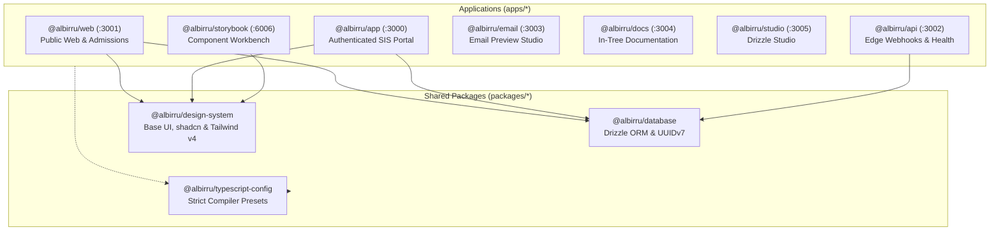

# Al-Birru School Information System (`albirru-sis`)

[](https://nextjs.org/)
[](https://react.dev/)
[](https://www.typescriptlang.org/)
[](https://tailwindcss.com/)
[](https://orm.drizzle.team/)
[](https://neon.tech/)
[](https://vercel.com/)
[](LICENSE)

> Official Institutional Governance Platform of **Al-Birru Primary School**.  
> Engineered with a Modern Modular Monolith architecture, Fine-Line Boxy Brutalism design system, end-to-end static type safety, and serverless edge cloud infrastructure.

---

## 🏛️ Institutional Credentials

- **Institution**: Al-Birru Primary School
- **National School Identification Number**: `70010111`
- **Accreditation Authority**: National Accreditation Board — Grade A
- **Governing Foundation**: Yayasan Amal Cahaya Indonesia
- **Medium of Instruction**: English Immersion and Bilingual Education
- **Campus Location**: Cicantayan, Sukabumi, West Java, Indonesia

---

## 🌐 Live Environments

| Environment | Git Branch | Canonical URL | Infrastructure Status |
| :--- | :--- | :--- | :--- |
| **Production** | `main` | [albirru.mafrilearth.com](https://albirru.mafrilearth.com) |  |
| **Staging** | `staging` | [staging.albirru.mafrilearth.com](https://staging.albirru.mafrilearth.com) |  |
| **Development** | `dev` | [dev.albirru.mafrilearth.com](https://dev.albirru.mafrilearth.com) |  |

---

## 📦 Monorepo Applications & Packages

Built on Turborepo and pnpm workspaces following the enterprise **next-forge** pattern across 7 applications and 3 shared packages:



### Applications (`apps/*`)
- **[`apps/web`](apps/web)** (`@albirru/web` — Port 3001): Public institutional portal, accreditation showcase, and admissions portal (protected by Cloudflare Turnstile and Upstash Redis rate limiting).
- **[`apps/app`](apps/app)** (`@albirru/app` — Port 3000): Authenticated internal School Information System (SIS) for administrative operations, master identity, attendance, and grading.
- **[`apps/api`](apps/api)** (`@albirru/api` — Port 3002): Edge API microservice, health check monitoring (`/health`), and webhook ingress (Clerk, Resend).
- **[`apps/email`](apps/email)** (`@albirru/email` — Port 3003): Transactional email template development and preview studio powered by React Email and Resend SDK.
- **[`apps/docs`](apps/docs)** (`@albirru/docs` — Port 3004): Technical documentation viewer.
- **[`apps/studio`](apps/studio)** (`@albirru/studio` — Port 3005): Visual database administration console powered by Drizzle Studio (`drizzle-kit studio`).
- **[`apps/storybook`](apps/storybook)** (`@albirru/storybook` — Port 6006): Isolated frontend user interface component workshop and visual test bench.

### Shared Packages (`packages/*`)
- **[`packages/database`](packages/database)** (`@albirru/database`): Relational schemas (Drizzle ORM), UUIDv7 keys, audit columns, and connection pool client.
- **[`packages/design-system`](packages/design-system)** (`@albirru/design-system`): Standardized design system library (Base UI and shadcn primitives, Tailwind CSS v4 variables).
- **[`packages/typescript-config`](packages/typescript-config)** (`@albirru/typescript-config`): Centralized TypeScript compiler configurations (`base.json`, `nextjs.json`, `react-library.json`).

---

## 🧩 Core Domain Modules

Business logic is encapsulated under `src/modules/{domain}/` with strict public boundary interfaces:

1. **Identity & Access Management (`identity`)**: Centralized accounts (Administrator, Instructor, Guardian, Student) backed by UUIDv7 keys and role-based access control.
2. **Online Admissions (`admissions`)**: Prospective student registration workflow shielded by Cloudflare Turnstile and Upstash Redis rate limiting.
3. **Attendance Tracking (`attendance`)**: Cohort attendance sessions (Present, Sick, Excused, Absent) with post-verification immutability locking.
4. **Grading & Report Cards (`grading`)**: Decimal weighted grade calculations (100% precision) and digital semester report card freezing.
5. **Guardian Self-Service (`guardian`)**: Read-only portal for dependent attendance monitoring and digital report card retrieval.

---

## 📚 Canonical Governance & Technical Specifications

Each operational aspect is governed by dedicated, non-overlapping canonical specifications at the repository root:

| Specification Document | Focus Area & Responsibility | Standard Compliance |
| :--- | :--- | :--- |
| **[`ARCHITECTURE.md`](ARCHITECTURE.md)** | Modular Monolith topology, subdomain routing, C4 component diagrams, and domain boundaries. | IEEE 1016 / next-forge |
| **[`DATABASE.md`](DATABASE.md)** | PostgreSQL relational schema, RFC 9562 UUIDv7 primary keys, soft-deletion, and Drizzle migrations. | RFC 9562 / ACID |
| **[`DESIGN.md`](DESIGN.md)** | Mathematical 8px spatial grid, Major Third typography (1.250), semantic CSS tokens, and accessibility. | W3C WCAG 2.1 AA |
| **[`DEPLOYMENT.md`](DEPLOYMENT.md)** | Vercel Edge Serverless runbook, Cloudflare WAF/DNS topology, CI quality gates, and instant rollback. | Production DevOps |
| **[`ENVIRONMENT.md`](ENVIRONMENT.md)** | Environment variables audit matrix: classification (Public vs Secret), format, and dashboard origin. | DevSecOps Standard |
| **[`TESTING.md`](TESTING.md)** | Testing pyramid strategy: Vitest unit tests, Playwright browser E2E, and Storybook visual testing. | QA Best Practices |
| **[`AGENTS.md`](AGENTS.md)** | Autonomous agent operational constitution, 24 agent skills matrix, and hard invariants enforcement. | AI SDLC Standard |
| **[`SECURITY.md`](.github/SECURITY.md)** | Vulnerability disclosure SLA, threat model, Cloudflare Turnstile bot deterrence, and Upstash rate limits. | ISO/IEC 29147 |
| **[`GOVERNANCE.md`](GOVERNANCE.md)** | Institutional leadership roles (Foundation Board, Lead Architect), decision-making models (Lazy Consensus, RFC/ADR). | CNCF Governance Model |
| **[`ROADMAP.md`](ROADMAP.md)** | Multi-phase strategic roadmap (2026–2027): v0.1.0 baseline through v0.4.0 national registry and offline sync. | Agile Milestones |
| **[`CONTRIBUTING.md`](.github/CONTRIBUTING.md)** | Git branch lifecycle (`dev` -> `staging` -> `main`), Conventional Commits 1.0.0, and Husky quality gates. | GitHub Standard |
| **[`CHANGELOG.md`](CHANGELOG.md)** | Chronological version release log following Semantic Versioning 2.0.0 and Keep a Changelog. | Keep a Changelog 1.1.0 |
| **[`CODE_OF_CONDUCT.md`](.github/CODE_OF_CONDUCT.md)** | Community ethical standards, respectful collaboration guidelines, and incident reporting. | Contributor Covenant 2.1 |
| **[`SUPPORT.md`](.github/SUPPORT.md)** | Official support channels for admissions inquiries, guardian academic desk, bug reports, and security. | GitHub Community Spec |
| **[`AUTHORS.md`](AUTHORS.md)** | Intellectual property accreditation for Yayasan Amal Cahaya Indonesia, Academic Board, and engineering. | GNU/Linux Standard |
| **[`LICENSE`](LICENSE)** | Formal open-source legal rights and copyright conditions (MIT License). | OSI Approved License |
| **[`.github/CODEOWNERS`](.github/CODEOWNERS)** | Automatic reviewer assignment mapping per directory module and security configuration. | GitHub Branch Protection |

---

## 🛠️ Curated Technology Stack

| Layer | Selected Technology | Version | Purpose |
| :--- | :--- | :--- | :--- |
| **Language** | TypeScript | `^5.x` | Strict type safety across all workspaces |
| **Package Manager** | pnpm | `12.11.2` | Workspace dependency isolation |
| **Build Engine** | Turborepo | `^2.4.4` | Build orchestration and task caching |
| **Framework** | Next.js | `16.3.8` | App Router, React Server Components, Server Actions |
| **UI Library** | React / React DOM | `19.2.8` | Component model and modern actions |
| **Styling** | Tailwind CSS | `v4.x` | CSS-first configuration and semantic CSS variables |
| **Headless UI** | Base UI / shadcn | `^1.8.0` / `^0.3.1` | Accessible component primitives (WCAG 2.1 AA) |
| **Database** | Neon PostgreSQL | `16+` | Serverless relational data store |
| **ORM & Migrations** | Drizzle ORM / Drizzle Kit | `^0.45.3` / `^0.31.11` | Type-safe query builder and SQL migration generator |
| **Authentication** | Clerk | `^6.12.0` | Multi-subdomain single sign-on and role-based access control |
| **Rate Limiter** | Upstash Redis | `^2.2.0` / `^1.39.0` | Sliding window rate limiting over serverless REST |
| **Bot Deterrence** | Cloudflare Turnstile | Cloud API | Non-intrusive CAPTCHA challenge |
| **Form Validation** | Zod / React Hook Form | `^3.25.76` / `^7.54.2` | Runtime schema parsing and form controller |
| **Email Delivery** | Resend / React Email | `^6.32.0` / `^1.0.12` | Transactional email dispatch and React templates |
| **Test Runner** | Vitest / Playwright | `^4.x` / `^1.64.0` | Fast unit tests and cross-browser end-to-end testing |
| **Linter & Formatter** | Biome | `^2.5.15` | Sub-200ms unified code verification |
| **Git Automation** | Husky / Commitlint | `^9.1.7` / `^21.2.3` | Pre-commit Biome checks and Conventional Commits enforcement |

---

## 🚀 Quick Start Guide

### 1. Prerequisites
- **Node.js**: `>= 20.18.0` (Recommended: `v22.x LTS`)
- **Package Manager**: `pnpm` version `12.x`
- **Database**: Active Neon Serverless PostgreSQL instance

### 2. Setup
```bash
# Clone the repository
git clone https://github.com/Mafrilearth/albirru-school-management-monorepo.git
cd albirru-school-management-monorepo

# Switch to development branch
git checkout dev

# Install dependencies
pnpm install

# Initialize local environment variables
cp .env.example .env.local
```

### 3. Essential Operational Commands
```bash
# Start all development servers
pnpm run dev

# Execute full production build
pnpm run build

# Run Biome code quality and format checks
pnpm run check

# Run static type verification across all workspaces
pnpm run check-types

# Execute automated test suite
pnpm run test

# Generate database migrations
pnpm run db:generate

# Launch visual database editor
pnpm run db:studio
```

---

## 📜 License & Copyright

Distributed under the official [MIT License](LICENSE).  
Copyright © 2026 **Yayasan Amal Cahaya Indonesia** / **Al-Birru Primary School**. All rights reserved.
