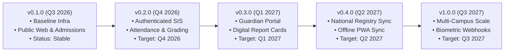

# Strategic Product & Engineering Roadmap

This document outlines the strategic development milestones and engineering roadmap for the **Al-Birru School Information System (`albirru-sis`)**.

---

## 🗺️ Engineering Progression Timeline

---

## 🎯 Current Milestone: v0.1.0 (Baseline Infrastructure & Public Portal)
*Status: Completed & Stable*

- [x] **Turborepo Modular Monolith**: Deployed 7 Next.js 16 applications and 3 shared packages.
- [x] **Relational Schema & Drizzle ORM**: Implemented RFC 9562 UUIDv7 keys, audit columns, and strict soft-delete invariants.
- [x] **Public Web Portal (`apps/web`)**: Institutional profile, accreditation credentials (National School Identification Number: `70010111`, National Accreditation Board — Grade A), news, curriculum showcase, and feedback collector.
- [x] **Online Student Admissions**: Registration flow protected by Cloudflare Turnstile bot deterrence and Upstash Redis rate limiting.
- [x] **Zero-Overhead Toolchain**: Biome v2 unified linter/formatter, Husky git automation, Commitlint, and Vitest test suite.

---

## 🚀 Milestone 1: v0.2.0 — Authenticated SIS Portal & Core Academics
*Target: Q4 2026*

- [ ] **Master Identity & RBAC Provisioning**:
  - Full synchronization between Clerk user directory and PostgreSQL `users` / `profiles` tables.
  - Role-based access control for Administrator, Instructor, Guardian, and Student personas.
- [ ] **Daily Sequential Attendance Tracking**:
  - Roster initialization for classroom cohorts.
  - Quick-action attendance markers (`Present`, `Sick`, `Excused`, `Absent`).
  - Immutability locking post-finalization by classroom teachers.
- [ ] **Weighted Gradebook Computation**:
  - Configurable formative and summative assessment weighting (100% decimal precision).
  - Subject-level grade recording with automatic GPA and ranking metrics.

---

## 📊 Milestone 2: v0.3.0 — Guardian Self-Service & Digital Report Cards
*Target: Q1 2027*

- [ ] **Guardian Self-Service Portal**:
  - Dependent student attendance timeline and real-time alerts for absences.
  - Academic progress radar charts and assessment breakdown.
- [ ] **Digital Semester Report Card Engine**:
  - High-fidelity PDF report card generation rendered with React-based print layouts.
  - Archival storage on Cloudflare R2 with zero-egress digital distribution.
  - QR Code digital signature verification for report card authenticity.

---

## 🌐 Milestone 3: v0.4.0 — Statutory Integrations & Offline Resilience
*Target: Q2 2027*

- [ ] **National Education Registry Synchronization Adapters**:
  - Data interchange bridges for national education databases and institutional registries.
  - Validation rules conforming to statutory national student and institution identifier formats.
- [ ] **Offline-First PWA for Field Operations**:
  - Service Worker caching with background sync for rural campus environments.
  - Local attendance queue persistence with optimistic UI updates.

---

## 🔮 Future Vision: v1.0.0 — Multi-Campus Foundation
*Target: Q3 2027*

- [ ] Multi-branch campus isolation under Yayasan Amal Cahaya Indonesia.
- [ ] Advanced biometric attendance integration with hardware terminal webhooks.
- [ ] AI-assisted student tahfidz memorization analytics and progression forecasting.
