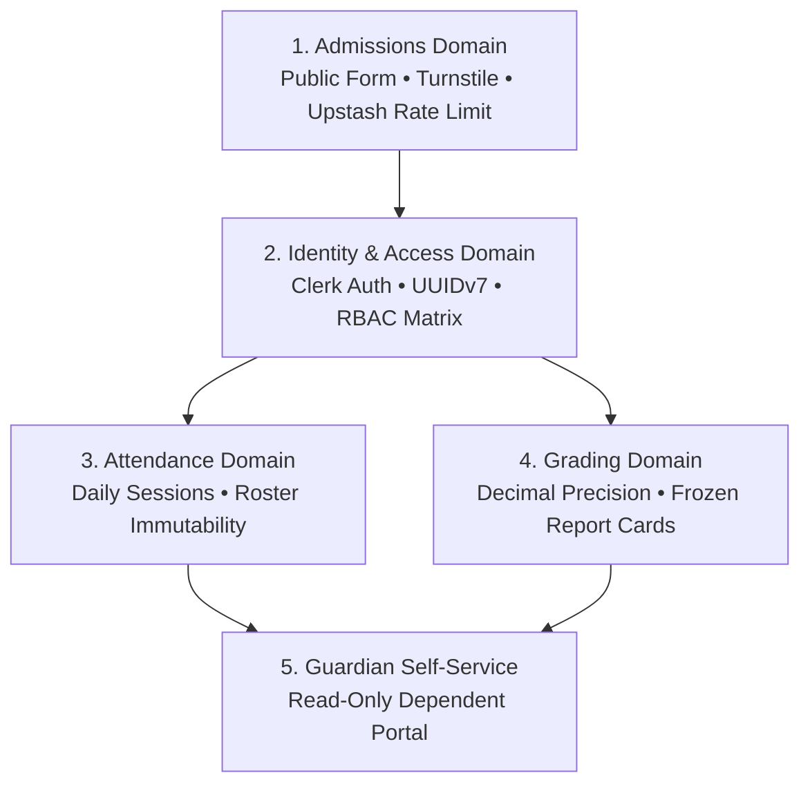

# Product Requirements Document

**Document Status:** Approved & Authoritative  
**Standard Compliance:** ISO/IEC/IEEE 29148:2018 (Requirements Engineering Standard)  
**System Scope:** Core SIS Functional Domains across `apps/web` and `apps/app`  
**Enforcement Level:** Non-Negotiable Functional Bounds (Zero Scope Creep)  

---

## 1. Executive Vision & Scope

Al-Birru School Information System (`albirru-sis`) is the unified digital governance platform for Al-Birru Primary School. The system consolidates public institutional marketing, prospective student admissions, daily multi-session attendance, weighted academic grading, and guardian self-service into an integrated Next.js modular monolith without external third-party Content Management System dependencies.

---

## 2. Core Functional Domains

### 2.1 Online Admissions (`admissions`)
- **Public Workflow:** Prospective student registration on `apps/web` (`/admissions`).
- **Bot Deterrence:** Cloudflare Turnstile token verification on submission.
- **Ingress Throttling:** Upstash Redis sliding-window rate limit (maximum 5 submissions per 15 minutes per IP address).
- **Administrative Adjudication:** Review, document verification, interview scheduling, and status transitions (Pending, Verified, Accepted, Rejected) in `apps/app` (`/admin`).

### 2.2 Identity & Access Management (`identity`)
- **Single Sign-On:** Clerk Authentication with centralized session resolution.
- **Primary Keys:** RFC 9562 UUIDv7 keys generated via `$defaultFn(() => uuidv7())`.
- **Role-Based Access Control:**
  - `Administrator`: Full system provisioning, admissions review, and system configuration.
  - `Instructor`: Class session attendance logging, weighted gradebook entry.
  - `Guardian`: Read-only academic access for verified dependents.
  - `Student`: Read-only view for assignments, daily schedule, and transcripts.

### 2.3 Attendance Tracking (`attendance`)
- **Cohort Sessions:** Multi-session daily attendance tracking (Morning Assembly, Main Classes, Tahfidz).
- **Status Enumerations:** Present, Sick, Excused, Absent.
- **Immutability Lock:** Attendance rosters freeze automatically upon instructor submission and administrative verification. Zero retro-modification without audited administrative unlock.

### 2.4 Grading & Report Cards (`grading`)
- **Weighted Computation:** Exact decimal calculations for Formative, Summative, and Extracurricular criteria.
- **Decimal Precision:** Stored using PostgreSQL `numeric(5, 2)` to eliminate floating-point rounding errors.
- **Semester Freezing:** Finalized semester report cards are cryptographically frozen and exportable as digital reports.

### 2.5 Guardian Self-Service (`guardian`)
- **Dependent Linking:** Verified relational mapping between guardians and registered students.
- **Real-Time Visibility:** Daily attendance status indicators and academic progress alerts.
- **Report Retrieval:** Authenticated download of frozen semester report cards.

---

## 3. Non-Functional Requirements

| Metric | Target Threshold | Verification Standard |
| :--- | :--- | :--- |
| **Edge Serverless Latency** | `p95 < 200ms` | Vercel Edge Insights & Turborepo build budget |
| **Accessibility Compliance** | `100% WCAG 2.1 AA` | Automated `axe-core` and Chrome DevTools audits |
| **Data Integrity** | `Zero Physical Delete` | Logical soft-deletion via `is_active: boolean` |
| **Type Safety** | `Zero any, Zero @ts-ignore` | Strict TypeScript compiler verification (`tsc --noEmit`) |
| **Audit Compliance** | `Mandatory Timestamps` | `created_at`, `updated_at`, `created_by` on all operational tables |
