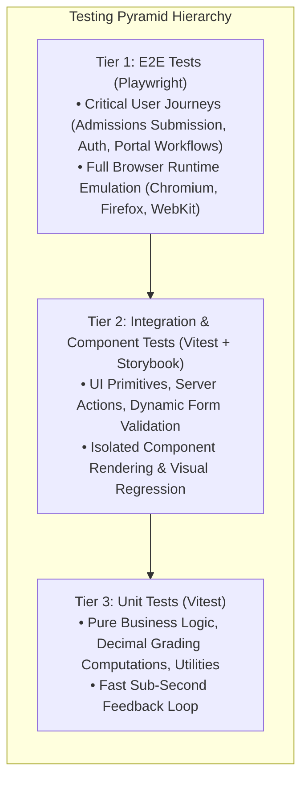

# Quality Assurance & Testing Engineering

**Document Status:** Approved & Authoritative  
**Standard Compliance:** ISTQB Test Engineering Standard, W3C WCAG 2.1 AA Audit  
**System Scope:** Unit, Integration, Component Isolation, and End-to-End Tests  
**Enforcement Level:** Non-Negotiable Hard Invariant (100% Pass Required)  

This document outlines the testing strategy, tools, and quality gates for the **Al-Birru School Information System (`albirru-sis`)**.

---

## 1. The Testing Pyramid

Our testing suite follows the industry-standard three-tier testing hierarchy:



---

## 2. Testing Frameworks & Tooling

| Test Type | Framework | Purpose |
| :--- | :--- | :--- |
| **Unit & Integration** | **Vitest (`vitest`)** | Fast, native ESM unit test execution for validation schemas, utilities, and Server Actions. |
| **End-to-End (E2E)** | **Playwright (`playwright`)** | Cross-browser emulation (Chromium, Firefox, WebKit) for end-to-end user workflows. |
| **Component Isolation** | **Storybook (`storybook`)** | Isolated UI component visual verification and edge-case rendering. |
| **Accessibility (a11y)** | **axe-core** | Automated audit for W3C WCAG 2.1 AA compliance (contrast, ARIA roles, focus order). |

---

## 3. Running Tests Locally

```bash
# Run all unit and integration tests across the monorepo
pnpm run test

# Run tests in watch mode for active development
pnpm --filter @albirru/web test -- --watch

# Launch Storybook visual workbench (Port 6006)
pnpm --filter @albirru/storybook dev
```

---

## 4. Test Authoring Conventions

1. **Deterministic Assertions**: Tests must not rely on random numbers, dynamic clocks without mocks, or unseeded test databases.
2. **DAMP over DRY**: Descriptive, explicit test setup is preferred over premature test helper abstractions.
3. **Zero False Positives**: Tests that pass without asserting actual state modifications (`expect(true).toBe(true)`) are strictly forbidden.
