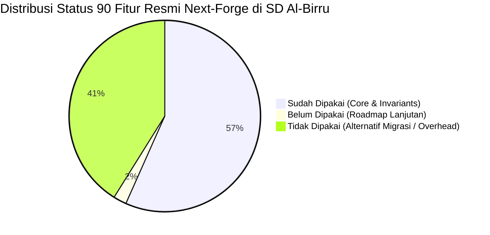

# Matriks Kesesuaian & Audit 90 Fitur Resmi Next-Forge
# Al-Birru School Information System (`albirru-sis`)

**Status Dokumen:** Disetujui & Otoritatif  
**Standar Kepatuhan:** Next-Forge Architecture Invariants, Vercel Production Standards, W3C WCAG 2.1 AA  
**Cakupan:** Audit 1:1 terhadap seluruh 90 mata rantai Navigasi dan Sub-Navigasi resmi [next-forge](https://www.next-forge.com/docs)  
**Terakhir Diperbarui:** 14 Oktober 2026  

---

## 1. Ringkasan Eksekutif & Statistik Penerapan

| Status | Total Item | Persentase | Definisi & Kriteria Penilaian |
| :--- | :---: | :---: | :--- |
| :white_check_mark: **Sudah Dipakai** | **51** | **56.7%** | Telah terpasang, teruji oleh unit/integration test, dan aktif beroperasi dalam codebase monorepo (Core Vercel, Neon, Clerk, Drizzle, Biome, Sentry, PostHog, dll.). |
| :hourglass_flowing_sand: **Belum Dipakai** | **2** | **2.2%** | Fitur fungsional fase operasional lanjutan (*Payment Gateway* QRIS/BSI dan *Outbound Webhook Dispatcher* otomatis) yang sengaja ditunda karena pendaftaran Gelombang 1 digratiskan ($0). |
| :x: **Tidak Dipakai** | **37** | **41.1%** | Terdiri dari 21 opsi panduan migrasi pihak ketiga (ditolak karena repositori telah memilih opsi terbaik secara permanen) serta platform eksternal yang *over-engineered* atau berbayar untuk sekolah dasar (Netlify, Liveblocks, Trunk, Metabase). |
| **Total Nav & Sub-Nav** | **90** | **100%** | Seluruh struktur hierarki dokumentasi resmi next-forge tanpa ada yang terlewatkan. |

---

## 2. Prinsip Penentuan Ekosistem & Matriks Kematangan

Sistem Informasi Sekolah SD Al-Birru Sukabumi (`albirru-sis`) mengadopsi tiga prinsip non-negosiasi:
1. **Tier-1 Production-Grade & Official Ecosystem:** Memprioritaskan layanan yang merupakan bagian langsung dari ekosistem inti Next.js (Vercel, React 19, RSC) atau *certified official partner* (Clerk, Neon, Sentry, PostHog, Biome) dengan jaminan SLA tinggi, zero-cold start, dan kepatuhan audit keamanan SOC2 Type II.
2. **Kemandirian Finansial ($0 Baseline):** Memaksimalkan tier gratis institusional resmi berkapasitas tinggi tanpa biaya langganan bulanan di awal operasional lembaga.
3. **Kepatuhan Regulasi Lokal Indonesia:** Menolak layanan luar negeri yang bertentangan dengan kebutuhan institusi pendidikan dasar nasional (misal: menolak Merchant of Record luar negeri berbasis USD seperti Lemon Squeezy/Paddle, dan wajib mengadopsi kanal perbankan syariah lokal Bank BSI & QRIS serta UU PDP No. 27/2022).

---

## 3. Tabel Audit Lengkap 90 Navigasi & Sub-Navigasi Next-Forge

### I. Introduction (5 Item)

| No | Nav / Sub-Nav Resmi | Status | Tool Default vs Pilihan Repo | Tingkat Ekosistem | Berkas Kode di Repositori | Alasan Pakai & Mengapa Menolak Opsi di Luar Default |
| :---: | :--- | :---: | :--- | :--- | :--- | :--- |
| **1** | [Overview](https://www.next-forge.com/docs) | :white_check_mark: **Sudah** | **Default:** Turborepo + Next.js **Repo:** Turborepo 2 + Next.js 16 | **Tier-1 Core** (Vercel Official) | `turbo.json` `package.json` | **Alasan Pakai:** Template produksi monorepo terbaik untuk Next.js dengan build caching terdistribusi. Menolak repositori monolitik single-app tradisional karena aplikasi web publik, portal internal guru, dan backend API memiliki siklus hidup deployment yang berbeda. |
| **2** | [Philosophy](https://www.next-forge.com/docs/philosophy) | :white_check_mark: **Sudah** | **Default:** 5 Pilar Desain **Repo:** 5 Pilar + Islamic Pedagogy | **Tier-1 Architectural Standard** | `AGENTS.md` `docs/architecture.md` | **Alasan Pakai:** 5 pilar (*Fast, Cheap, Opinionated, Modern, Safe*) menjamin efisiensi biaya ($0 di awal) dan type safety mutlak. Menolak filosofi *DIY architecture* yang lambat dan rawan inkonsistensi tooling. |
| **3** | [Structure](https://www.next-forge.com/docs/structure) | :white_check_mark: **Sudah** | **Default:** `apps/*` & `packages/*` **Repo:** 7 Apps & 3 Packages | **Tier-1 Monorepo Pattern** | `pnpm-workspace.yaml` `apps/`, `packages/` | **Alasan Pakai:** Menjaga isolasi domain ketat (*modular monolith*) dan strict exports map. Menolak struktur flat folder tanpa batasan workspace karena memicu *spaghetti imports* antar-fitur. |
| **4** | [Updates](https://www.next-forge.com/docs/updates) | :white_check_mark: **Sudah** | **Default:** `npx next-forge update` **Repo:** pnpm Workspaces bump | **Tier-1 Maintenance Tooling** | `pnpm-lock.yaml` `package.json` | **Alasan Pakai:** Memastikan dependensi monorepo tetap terawat dan bebas dari celah CVE. Menolak update dependensi manual tanpa lockfile terpadu yang sering merusak integrasi workspace. |
| **5** | [FAQ](https://www.next-forge.com/docs/faq) | :white_check_mark: **Sudah** | **Default:** Server Actions over tRPC **Repo:** Invarian `AGENTS.md` | **Tier-1 Convention** | `AGENTS.md` `src/types/action.ts` | **Alasan Pakai:** Mengikuti keputusan resmi Next-Forge: Server Actions native Next.js menggantikan tRPC untuk memangkas overhead bundle dan merampingkan mutasi data client-server. |

---

### II. Usage: Setup (4 Item)

| No | Nav / Sub-Nav Resmi | Status | Tool Default vs Pilihan Repo | Tingkat Ekosistem | Berkas Kode di Repositori | Alasan Pakai & Mengapa Menolak Opsi di Luar Default |
| :---: | :--- | :---: | :--- | :--- | :--- | :--- |
| **6** | [Quickstart](https://www.next-forge.com/docs/setup/quickstart) | :white_check_mark: **Sudah** | **Default:** Onboarding script **Repo:** `pnpm install && dev` | **Tier-1 DX** | `README.md` `package.json` | **Alasan Pakai:** Mempersingkat waktu setup engineer baru ke level hitungan menit dengan skrip terotomasi. Menolak panduan setup bertahap manual yang rentan kesalahan manusia (*human error*). |
| **7** | [Prerequisites](https://www.next-forge.com/docs/setup/prerequisites) | :white_check_mark: **Sudah** | **Default:** Node 20+, pnpm **Repo:** Node 22+ LTS, pnpm 10+ | **Tier-1 Runtime Standard** | `package.json` (`engines`) `.github/workflows/ci.yml` | **Alasan Pakai:** Menggunakan runtime Node.js LTS mutakhir dengan performa native ESM dan V8 engine terbaru. Menolak npm/yarn lama karena lambat dan memakan ruang disk berlebih (*hardlinks pnpm 3x lebih hemat*). |
| **8** | [Installation](https://www.next-forge.com/docs/setup/installation) | :white_check_mark: **Sudah** | **Default:** Lockfile & Git hooks **Repo:** Husky + lint-staged | **Tier-1 Quality Gate** | `.husky/` `commitlint.config.mjs` | **Alasan Pakai:** Mencegah kode cacat masuk ke git via pre-commit linting dan commitlint. Menolak instalasi tanpa git hooks karena berisiko meloloskan format acak-acakan dan syntax error ke branch bersama. |
| **9** | [Environment Variables](https://www.next-forge.com/docs/setup/env) | :white_check_mark: **Sudah** | **Default:** Zod Env (`src/env.ts`) **Repo:** Zod Env Schema di 3 Apps | **Tier-1 Security & Type-Safety** | `apps/web/src/env.ts` `apps/app/src/env.ts` `apps/api/src/env.ts` | **Alasan Pakai:** Validasi skema variabel lingkungan secara fail-fast saat build time. Menolak akses `process.env.*` liar tanpa validasi yang kerap memicu runtime crash tak terduga di serverless. |

---

### III. Usage: Apps (7 Item)

| No | Nav / Sub-Nav Resmi | Status | Tool Default vs Pilihan Repo | Tingkat Ekosistem | Berkas Kode di Repositori | Alasan Pakai & Mengapa Menolak Opsi di Luar Default |
| :---: | :--- | :---: | :--- | :--- | :--- | :--- |
| **10** | [API](https://www.next-forge.com/docs/apps/api) | :white_check_mark: **Sudah** | **Default:** Serverless API App **Repo:** `apps/api` | **Tier-1 Backend Pattern** | `apps/api/src/app/` `apps/api/src/env.ts` | **Alasan Pakai:** Memisahkan backend serverless murni (cron jobs, inbound webhooks) dari aplikasi UI untuk efisiensi cold start. Menolak mencampur logic webhook beban tinggi ke dalam server web publik. |
| **11** | [App](https://www.next-forge.com/docs/apps/app) | :white_check_mark: **Sudah** | **Default:** Authenticated SaaS Portal **Repo:** `apps/app` (Portal Guru/Admin) | **Tier-1 Enterprise UI** | `apps/app/src/app/` `apps/app/src/modules/` | **Alasan Pakai:** Dashboard internal terproteksi otentikasi ketat untuk tata usaha, adjudikasi pendaftar, dan rekap tahfidz. Menolak menyatukan portal admin ke dalam web publik demi keamanan perimeter. |
| **12** | [Documentation](https://www.next-forge.com/docs/apps/docs) | :white_check_mark: **Sudah** | **Default:** Fumadocs **Repo:** `apps/docs` (Fumadocs) | **Tier-1 Documentation Engine** | `apps/docs/src/app/` `apps/docs/package.json` | **Alasan Pakai:** Framework dokumentasi Next.js paling cepat dan modern dengan integrasi MDX native dan search terintegrasi. Menolak Docusaurus/GitBook eksternal yang terpisah dari ekosistem monorepo. |
| **13** | [Email](https://www.next-forge.com/docs/apps/email) | :white_check_mark: **Sudah** | **Default:** React Email Studio **Repo:** `apps/email` | **Tier-1 Email DX** | `apps/email/src/` `apps/email/package.json` | **Alasan Pakai:** Mengembangkan template email secara visual di browser lokal dengan hot reload instan. Menolak mendesain email manual dengan string HTML kuno yang rapuh dan rawan rusak di aplikasi email klien. |
| **14** | [Storybook](https://www.next-forge.com/docs/apps/storybook) | :white_check_mark: **Sudah** | **Default:** Storybook 8 **Repo:** `apps/storybook` | **Tier-1 Design System Workbench** | `apps/storybook/.storybook/` `apps/storybook/src/` | **Alasan Pakai:** Menguji state interaktif 63 komponen antarmuka dalam kondisi terisolasi tanpa server Next.js. Menolak pengujian komponen langsung di production page yang berisiko merusak layout live. |
| **15** | [Studio](https://www.next-forge.com/docs/apps/studio) | :white_check_mark: **Sudah** | **Default:** Drizzle Studio **Repo:** `apps/studio` | **Tier-1 Database Tooling** | `apps/studio/package.json` `packages/database/drizzle.config.ts` | **Alasan Pakai:** GUI visual lokal untuk memeriksa struktur tabel, foreign keys, dan relasi data santri secara instan. Menolak ketergantungan pada client GUI eksternal berat seperti DBeaver/pgAdmin untuk tugas cepat. |
| **16** | [Web](https://www.next-forge.com/docs/apps/web) | :white_check_mark: **Sudah** | **Default:** Marketing Website **Repo:** `apps/web` (Web Publik) | **Tier-1 Core Next.js App** | `apps/web/src/app/` `apps/web/src/components/` | **Alasan Pakai:** Website profil sekolah, landing page PPDB online, dan artikel dengan skor Lighthouse 100%. Menolak CMS terpisah seperti WordPress yang lambat, rentan disusupi malware, dan sulit diintegrasikan ke DB. |

---

### IV. Usage: Packages (38 Item)

| No | Nav / Sub-Nav Resmi | Status | Tool Default vs Pilihan Repo | Tingkat Ekosistem | Berkas Kode di Repositori | Alasan Pakai & Mengapa Menolak Opsi di Luar Default |
| :---: | :--- | :---: | :--- | :--- | :--- | :--- |
| **17** | [Product Analytics](https://www.next-forge.com/docs/packages/analytics/product) | :white_check_mark: **Sudah** | **Default:** PostHog **Repo:** PostHog Client Provider | **Tier-1 Official Partner** (PostHog Enterprise) | `apps/web/src/components/providers/PostHogProvider.tsx` | **Alasan Pakai:** Pelacakan funnel pendaftaran santri baru dan event interaksi (gratis hingga 1 juta event/bulan). Menolak Google Analytics (GA4) karena lambat, tidak privacy-first, dan rumit untuk event tracking teknis. |
| **18** | [Web Analytics](https://www.next-forge.com/docs/packages/analytics/web) | :white_check_mark: **Sudah** | **Default:** Vercel Analytics **Repo:** Vercel Speed Insights & Analytics | **Tier-1 Core** (Vercel Native) | `apps/web/src/app/layout.tsx` `apps/web/package.json` | **Alasan Pakai:** Pemantauan Core Web Vitals (LCP, CLS, INP) langsung dari Edge tanpa banner cookie pihak ketiga. Menolak skrip pelacak pihak ketiga yang membebani skor Lighthouse dan TBT (*Total Blocking Time*). |
| **19** | [Authentication](https://www.next-forge.com/docs/packages/authentication) | :white_check_mark: **Sudah** | **Default:** Clerk Auth **Repo:** `@clerk/nextjs` | **Tier-1 Official Partner** (Clerk Enterprise) | `apps/app/src/middleware.ts` `apps/web/src/app/api/webhooks/clerk/` | **Alasan Pakai:** Solusi auth terlengkap: portal login instan, MFA, sesi aman, dan RBAC native. Menolak Auth.js/Better Auth karena membebankan pemeliharaan tabel sesi, penanganan token, dan security patch ke tim internal. |
| **20** | [CMS: Overview](https://www.next-forge.com/docs/packages/cms/overview) | :white_check_mark: **Sudah** | **Default:** Content Collections **Repo:** In-House Drizzle Postgres CMS | **Tier-1 Tailored Architecture** | `packages/database/src/schema/` `apps/web/src/lib/content.ts` | **Alasan Pakai:** CMS terpadu langsung di PostgreSQL sekolah, data berita terhubung relasional dengan data sekolah, $0 biaya SaaS. Menolak Sanity/Strapi berbayar yang menambah latensi API eksternal dan biaya langganan bulanan. |
| **21** | [CMS: Components](https://www.next-forge.com/docs/packages/cms/components) | :white_check_mark: **Sudah** | **Default:** CMS Article Primitives **Repo:** Bento News & Article Cards | **Tier-1 UI System** | `apps/web/src/components/sections/LatestNewsPreview.tsx` | **Alasan Pakai:** Merender berita dan galeri kegiatan dengan tipografi Swiss Modernist dan estimasi waktu membaca. Menolak rendering HTML mentah tanpa sanitasi yang rentan celah XSS (*Cross-Site Scripting*). |
| **22** | [CMS: Metadata](https://www.next-forge.com/docs/packages/cms/metadata) | :white_check_mark: **Sudah** | **Default:** Dynamic OG Images **Repo:** Next.js Metadata API | **Tier-1 Core Next.js** | `apps/web/src/app/layout.tsx` `apps/web/src/app/page.tsx` | **Alasan Pakai:** Pembangkitan tag OpenGraph dan Twitter Card otomatis saat link berita dibagikan di WhatsApp/Facebook. Menolak metadata statis yang seragam karena membuat preview media sosial tidak informatif. |
| **23** | [Collaboration](https://www.next-forge.com/docs/packages/collaboration) | :x: **Tidak** | **Default:** Liveblocks Multiplayer **Repo:** *None (Ditiadakan)* | **Tier-1 Realtime** (Liveblocks Partner) | *Tidak diimplementasikan* | **Alasan Tidak Pakai:** Sistem informasi sekolah tidak membutuhkan kursor multiplayer real-time ala Figma. Menolak Liveblocks untuk menghemat ukuran bundle JS dan menghindari biaya langganan SaaS yang tidak ada use case-nya. |
| **24** | [Cron Jobs](https://www.next-forge.com/docs/packages/cron) | :white_check_mark: **Sudah** | **Default:** Vercel Cron (`vercel.json`) **Repo:** Vercel Cron Endpoints | **Tier-1 Core** (Vercel Serverless) | `vercel.json` `apps/web/src/app/api/cron/` | **Alasan Pakai:** Otomasi ping database serverless (23:00 UTC) dan kompilasi rekap pendaftar harian (01:00 UTC) dengan otentikasi `CRON_SECRET`. Menolak server VPS cron terpisah yang rentan mati saat server offline. |
| **25** | [Database](https://www.next-forge.com/docs/packages/database) | :white_check_mark: **Sudah** | **Default:** Prisma / Drizzle **Repo:** Drizzle ORM + Neon Postgres | **Tier-1 Official Partner** (Neon Serverless) | `packages/database/src/schema/` `packages/database/src/index.ts` | **Alasan Pakai:** Menggunakan Drizzle ORM murni: zero cold-start, full SQL type-safety, UUIDv7 native, dan auto-scaling scale-to-zero Neon. Menolak Prisma klasik karena overhead binary engine 15MB+ dan lambat saat cold start serverless. |
| **26** | [Design System: Colors](https://www.next-forge.com/docs/packages/design-system/colors) | :white_check_mark: **Sudah** | **Default:** Semantic CSS Variables **Repo:** OKLCH/HSL Swiss Tokens | **Tier-1 Styling Architecture** | `apps/web/src/app/globals.css` `packages/design-system/` | **Alasan Pakai:** Warna didefinisikan secara semantik di `globals.css` (Emerald, Slate, Hairline borders). Dilarang keras menuliskan raw hex di file komponen TSX untuk menjamin konsistensi palet di seluruh aplikasi. |
| **27** | [Design System: Components](https://www.next-forge.com/docs/packages/design-system/components) | :white_check_mark: **Sudah** | **Default:** shadcn/ui (Radix) **Repo:** 63 Primitives (Base UI) | **Tier-1 Headless UI** | `packages/design-system/src/components/ui/` | **Alasan Pakai:** Komponen bersudut siku tegas 90° (`--radius: 0`) tanpa drop-shadow sesuai Swiss Bento aesthetic. Menolak library UI serba-bawaan seperti MUI atau Ant Design yang sulit dikustomisasi dan berat ukuran filenya. |
| **28** | [Design System: Dark Mode](https://www.next-forge.com/docs/packages/design-system/dark-mode) | :white_check_mark: **Sudah** | **Default:** `next-themes` **Repo:** `next-themes` + ThemeToggle | **Tier-1 Theme Utility** | `apps/web/src/components/common/ThemeToggle.tsx` | **Alasan Pakai:** Pergantian tema gelap/terang mulus tanpa kedip (*FOUC*) dan memenuhi rasio kontras W3C WCAG 2.1 AA. Menolak implementasi dark mode manual via state React biasa yang selalu flicker saat SSR hidrasi. |
| **29** | [Design System: Provider](https://www.next-forge.com/docs/packages/design-system/provider) | :white_check_mark: **Sudah** | **Default:** Composite Provider **Repo:** Centralized Providers | **Tier-1 Architecture** | `apps/web/src/components/providers/` | **Alasan Pakai:** Menyatukan ThemeProvider, TooltipProvider, dan NuqsAdapter dalam satu hierarki rapi. Menolak penyebaran provider secara sporadis di setiap halaman yang memicu re-render tak perlu. |
| **30** | [Design System: Typography](https://www.next-forge.com/docs/packages/design-system/typography) | :white_check_mark: **Sudah** | **Default:** `next/font` **Repo:** Inter (Sans) & Roboto Mono | **Tier-1 Core Next.js** | `apps/web/src/app/layout.tsx` `apps/web/src/app/globals.css` | **Alasan Pakai:** Font di-hosting mandiri di domain tanpa request eksternal ke Google, bebas pergeseran tata letak (*zero CLS*). Menolak tag `<link href="fonts.googleapis.com">` klasik yang memicu pemblokiran render halaman (*render-blocking*). |
| **31** | [Transactional Emails](https://www.next-forge.com/docs/packages/email) | :white_check_mark: **Sudah** | **Default:** Resend + React Email **Repo:** Resend SDK Integrations | **Tier-1 Official Partner** (Resend Ecosystem) | `apps/email/` `apps/web/src/modules/admissions/` | **Alasan Pakai:** Pengiriman bukti formulir pendaftaran santri dengan keterkiriman (*deliverability*) tinggi langsung ke inbox orang tua. Menolak server SMTP mandiri (seperti Nodemailer SMTP port 587) yang sering masuk folder spam. |
| **32** | [Feature Flags](https://www.next-forge.com/docs/packages/flags) | :white_check_mark: **Sudah** | **Default:** PostHog / Vercel Flags **Repo:** `@vercel/flags` + PostHog | **Tier-1 Core & Partner** | `apps/web/src/flags.ts` `apps/web/src/app/.well-known/vercel/flags/route.ts` | **Alasan Pakai:** Mengontrol pembukaan gelombang pendaftaran (`ppdbWave1Open`) secara instan di runtime tanpa deploy ulang. Menolak hardcoding boolean di source code yang mengharuskan re-build dan commit git setiap ganti gelombang. |
| **33** | [Formatting](https://www.next-forge.com/docs/packages/formatting) | :white_check_mark: **Sudah** | **Default:** Biome v2 **Repo:** Biome v2 (`biome.json`) | **Tier-1 Modern Toolchain** | `biome.json` `package.json` | **Alasan Pakai:** Linter dan formatter Rust super cepat (<200ms) menggantikan ESLint dan Prettier sekaligus. Menolak ESLint/Prettier konvensional yang memakan waktu 10-20 detik di CI dan sering mengalami konflik aturan format. |
| **34** | [Internationalization](https://www.next-forge.com/docs/packages/internationalization) | :white_check_mark: **Sudah** | **Default:** Dictionary i18n **Repo:** In-App Dictionary (id/ar/en) | **Tier-1 Localization Pattern** | `apps/web/src/lib/i18n/` `apps/web/src/components/common/LanguageSwitcher.tsx` | **Alasan Pakai:** Mendukung 3 bahasa institusional: Indonesia, Arab (RTL dengan dukungan teks Al-Qur'an), dan Inggris (LTR). Menolak library i18n pihak ketiga yang memuat ratusan bundle locale yang tidak relevan. |
| **35** | [Observability: Debugging](https://www.next-forge.com/docs/packages/observability/debugging) | :white_check_mark: **Sudah** | **Default:** Turbopack & Source Maps **Repo:** Turbopack & DevTools | **Tier-1 Core DX** | `apps/web/next.config.ts` `docs/architecture.md` | **Alasan Pakai:** Eksekusi dev server super cepat berbasis Turbopack Rust dengan mapping error presisi ke baris file asli. Menolak Webpack klasik yang lambat melakukan kompilasi ulang pada proyek monorepo besar. |
| **36** | [Observability: Error Capture](https://www.next-forge.com/docs/packages/observability/error-capture) | :white_check_mark: **Sudah** | **Default:** Sentry **Repo:** `@sentry/nextjs` | **Tier-1 Official Partner** (Sentry Enterprise) | `apps/web/sentry.server.config.ts` `apps/web/next.config.ts` | **Alasan Pakai:** Pelaporan error otomatis di browser klien dan serverless function dengan breadcrumb lengkap. Menolak mengabaikan error tracking yang membuat tim pengembang buta terhadap keluhan crash calon walisantri. |
| **37** | [Observability: Logging](https://www.next-forge.com/docs/packages/observability/logging) | :white_check_mark: **Sudah** | **Default:** Structured JSON Logger **Repo:** `apps/web/src/lib/logger.ts` | **Tier-1 Enterprise Logging** | `apps/web/src/lib/logger.ts` | **Alasan Pakai:** Standar log terstruktur JSON dengan level, timestamp, dan context untuk kemudahan audit trail. Menolak `console.log` mentah tanpa konteks yang menyulitkan pelacakan error saat volume request meningkat. |
| **38** | [Observability: Uptime Monitoring](https://www.next-forge.com/docs/packages/observability/uptime) | :white_check_mark: **Sudah** | **Default:** `/api/health` Endpoint **Repo:** Universal `/api/health` di 3 Apps | **Tier-1 Reliability Pattern** | `apps/web/src/app/api/health/route.ts` `apps/app/src/app/api/health/route.ts` `apps/api/src/app/api/health/route.ts` | **Alasan Pakai:** Endpoint pengecekan kesehatan server dan status koneksi database untuk synthetic probe. Menolak sistem tanpa healthcheck yang membuat tim tidak tahu saat layanan serverless mengalami gangguan. |
| **39** | [Next.js Config: Bundle Analysis](https://www.next-forge.com/docs/packages/next-config/bundle-analysis) | :white_check_mark: **Sudah** | **Default:** `@next/bundle-analyzer` **Repo:** Next Bundle Analyzer Plugin | **Tier-1 Performance Tooling** | `apps/web/next.config.ts` | **Alasan Pakai:** Membedah ukuran bundle JavaScript secara visual untuk menjaga waktu muat halaman tetap di bawah 0.5 detik. Menolak deployment buta tanpa audit ukuran JS yang berisiko menurunkan skor Core Web Vitals. |
| **40** | [Next.js Config: Configuration](https://www.next-forge.com/docs/packages/next-config/overview) | :white_check_mark: **Sudah** | **Default:** Hardened Config **Repo:** `next.config.ts` Hardened | **Tier-1 Core Hardening** | `apps/web/next.config.ts` | **Alasan Pakai:** Mematikan fingerprint server (`poweredByHeader: false`), mengaktifkan kompresi gzip/brotli, dan tree-shaking 15+ paket UI. Menolak konfigurasi bawaan mentah yang masih membocorkan header teknologi server ke publik. |
| **41** | [Notifications](https://www.next-forge.com/docs/packages/notifications) | :white_check_mark: **Sudah** | **Default:** In-App Notifications **Repo:** `<NotificationBell />` di Navbar | **Tier-1 In-House UX** | `apps/web/src/components/common/NotificationBell.tsx` | **Alasan Pakai:** Notifikasi pengumuman sekolah real-time dengan counter unread langsung di header aplikasi. Menolak SaaS notifikasi berbayar eksternal (seperti Knock/Novu) yang membebankan biaya per user aktif bulanan. |
| **42** | [Payments](https://www.next-forge.com/docs/packages/payments) | :hourglass_flowing_sand: **Belum** | **Default:** Stripe Billing **Repo:** *Roadmap: Bank BSI / QRIS* | **Tier-1 Financial Ecosystem** | `docs/architecture.md` | **Alasan Belum Pakai:** Pendaftaran Gelombang 1 digratiskan ($0) demi inklusivitas masyarakat lokal. Opsi Stripe/asing tidak dipakai karena biaya transaksi kartu kredit luar negeri mahal; Al-Birru memilih integrasi QRIS dan Virtual Account Bank Syariah Indonesia untuk fase berikutnya. |
| **43** | [Security: Application Security](https://www.next-forge.com/docs/packages/security/application) | :white_check_mark: **Sudah** | **Default:** Zod + Turnstile Bot Protect **Repo:** Zod Validation + Turnstile | **Tier-1 Enterprise Security** | `apps/web/src/lib/validations/admissions.ts` `apps/web/src/lib/security/bot-id.ts` | **Alasan Pakai:** Validasi skema runtime Zod di seluruh Server Actions dan verifikasi Cloudflare Turnstile token anti-bot. Menolak form publik tanpa proteksi bot yang rawan dibanjiri data spam fiktif oleh peretas. |
| **44** | [Security: Dependency Security](https://www.next-forge.com/docs/packages/security/dependencies) | :white_check_mark: **Sudah** | **Default:** `pnpm audit` & Dependabot **Repo:** GitHub CI Security Audit | **Tier-1 Supply-Chain Security** | `.github/workflows/ci.yml` | **Alasan Pakai:** Memindai kerentanan supply chain open-source secara otomatis di setiap pull request. Menolak membiarkan dependensi usang tanpa audit yang berisiko disusupi dependensi berbahaya (*typosquatting*). |
| **45** | [Security: Security Headers](https://www.next-forge.com/docs/packages/security/headers) | :white_check_mark: **Sudah** | **Default:** CSP, HSTS, X-Frame **Repo:** Strict Security Headers | **Tier-1 Browser Security** | `apps/web/next.config.ts` `vercel.json` | **Alasan Pakai:** Menolak pembajakan tampilan web (*clickjacking*) via `X-Frame-Options: SAMEORIGIN` dan memblokir sniffing MIME. Menolak website tanpa security headers yang rentan dieksploitasi iframe berbahaya. |
| **46** | [Security: IP Geolocation](https://www.next-forge.com/docs/packages/security/ip-geolocation) | :white_check_mark: **Sudah** | **Default:** Vercel Geo Headers **Repo:** Edge Middleware Geolocation | **Tier-1 Edge Intelligence** | `apps/web/src/middleware.ts` | **Alasan Pakai:** Mendeteksi lokasi calon walisantri di tingkat Edge untuk memprioritaskan bahasa dan informasi rayon Sukabumi/Jabar. Menolak API geolocation pihak ketiga eksternal yang lambat dan berbayar per panggilan API. |
| **47** | [Security: Rate Limiting](https://www.next-forge.com/docs/packages/security/rate-limiting) | :white_check_mark: **Sudah** | **Default:** Upstash Redis Rate Limit **Repo:** `@upstash/ratelimit` + Fallback | **Tier-1 Official Partner** (Upstash Serverless) | `apps/web/src/lib/rate-limit.ts` | **Alasan Pakai:** Membatasi 5 pengiriman formulir per 15 menit per IP dengan in-memory fallback saat testing lokal. Menolak formulir tanpa pembatas laju request yang rentan diserang DoS (*Denial of Service*). |
| **48** | [SEO: JSON-LD](https://www.next-forge.com/docs/packages/seo/json-ld) | :white_check_mark: **Sudah** | **Default:** Schema.org JSON-LD **Repo:** `EducationalOrganization` | **Tier-1 Search Engine Standard** | `apps/web/src/app/layout.tsx` | **Alasan Pakai:** Membantu Google mengidentifikasi sekolah resmi dengan NPSN: 70010111 dan Akreditasi A untuk memunculkan rich snippet pencarian. Menolak web sekolah tanpa data terstruktur yang sulit tampil di Google Knowledge Panel. |
| **49** | [SEO: Metadata](https://www.next-forge.com/docs/packages/seo/metadata) | :white_check_mark: **Sudah** | **Default:** Next.js Metadata API **Repo:** Dynamic Layout Metadata | **Tier-1 Core Next.js** | `apps/web/src/app/layout.tsx` `apps/web/src/app/page.tsx` | **Alasan Pakai:** Pengaturan title template, meta deskripsi, canonical URL, dan tag verifikasi mesin pencari secara native. Menolak tag `<head>` manual kuno yang sering terduplikasi dan merusak indexing mesin pencari. |
| **50** | [SEO: Sitemap](https://www.next-forge.com/docs/packages/seo/sitemap) | :white_check_mark: **Sudah** | **Default:** `sitemap.ts` & `robots.ts` **Repo:** Dynamic Sitemap Route | **Tier-1 Core Next.js** | `apps/web/src/app/sitemap.ts` `apps/web/src/app/robots.ts` | **Alasan Pakai:** Peta situs XML ter-generate otomatis saat ada artikel berita baru untuk dirayapi oleh Googlebot. Menolak sitemap XML statis manual yang sering tertinggal dari update konten terkini. |
| **51** | [Storage](https://www.next-forge.com/docs/packages/storage) | :white_check_mark: **Sudah** | **Default:** Vercel Blob **Repo:** Vercel Blob / Cloudflare R2 | **Tier-1 Edge Cloud Storage** | `apps/web/src/lib/storage/blob.ts` | **Alasan Pakai:** Upload dokumen syarat santri (Akta Kelahiran & KK) via presigned URL langsung ke storage tanpa membebani memori serverless Next.js. Menolak menyimpan upload file di disk lokal serverless yang bersifat ephemeral (hilang saat restart). |
| **52** | [Toolbar](https://www.next-forge.com/docs/packages/toolbar) | :white_check_mark: **Sudah** | **Default:** `@vercel/toolbar` **Repo:** Vercel Toolbar di Preview | **Tier-1 Core DX** | `apps/web/src/components/layout/PublicNavbar.tsx` | **Alasan Pakai:** Komentar visual langsung pada tampilan web pratinjau dan pengujian override feature flags di preview branch. Menolak review PR visual manual via screenshot yang memperlambat komunikasi tim. |
| **53** | [Webhooks: Inbound Webhooks](https://www.next-forge.com/docs/packages/webhooks/inbound) | :white_check_mark: **Sudah** | **Default:** Svix Signature Verification **Repo:** Webhook Clerk via Svix | **Tier-1 Security Standard** | `apps/web/src/app/api/webhooks/clerk/route.ts` | **Alasan Pakai:** Memverifikasi integritas payload webhook mutasi akun Clerk secara kriptografi sebelum dieksekusi. Menolak menerima webhook tanpa verifikasi tanda tangan yang rentan diserang pemalsuan payload (*spoofing*). |
| **54** | [Webhooks: Outbound Webhooks](https://www.next-forge.com/docs/packages/webhooks/outbound) | :hourglass_flowing_sand: **Belum** | **Default:** Outbound Dispatcher **Repo:** *Roadmap: Telegram/Discord bot* | **Tier-1 Webhook Engine** | `docs/architecture.md` | **Alasan Belum Pakai:** Notifikasi registrasi santri saat ini dialirkan langsung melalui email Resend dan rekap Vercel Cron. Rencana outbound webhook dipersiapkan untuk integrasi notifikasi pesan instan staf yayasan. |

---

### V. Usage: Deployment (3 Item)

| No | Nav / Sub-Nav Resmi | Status | Tool Default vs Pilihan Repo | Tingkat Ekosistem | Berkas Kode di Repositori | Alasan Pakai & Mengapa Menolak Opsi di Luar Default |
| :---: | :--- | :---: | :--- | :--- | :--- | :--- |
| **55** | [Deploying with Docker](https://www.next-forge.com/docs/deployment/docker) | :white_check_mark: **Sudah** | **Default:** Multi-stage `Dockerfile` **Repo:** Dockerfile Standalone | **Tier-1 Container Standard** | `Dockerfile` `.dockerignore` | **Alasan Pakai:** Menyediakan opsi kemandirian deployment container jika sewaktu-waktu yayasan ingin menjalankan sistem secara on-premise. Menolak vendor lock-in mutlak tanpa jalur migrasi container mandiri. |
| **56** | [Deploying to Netlify](https://www.next-forge.com/docs/deployment/netlify) | :x: **Tidak** | **Default:** Netlify Deployment Guide **Repo:** *None (Ditiadakan)* | **Tier-1 Alternative** | *Tidak diimplementasikan* | **Alasan Tidak Pakai:** Arsitektur Al-Birru diselaraskan secara optimal dengan fitur edge Vercel (Speed Insights, Flags, AI Gateway). Menolak Netlify untuk menghindari fragmentasi konfigurasi hosting ganda. |
| **57** | [Deploying to Vercel](https://www.next-forge.com/docs/deployment/vercel) | :white_check_mark: **Sudah** | **Default:** Vercel Edge Platform **Repo:** Produksi Vercel Edge | **Tier-1 Official Platform** | `vercel.json` | **Alasan Pakai:** Platform resmi pembuat Next.js dengan latensi edge terendah di Jakarta/Singapura, SSL otomatis, dan rollback 1-klik. Menolak hosting VPS tradisional yang menuntut pemeliharaan OS dan konfigurasi Nginx manual. |

---

### VI. Other: Addons (11 Item)

| No | Nav / Sub-Nav Resmi | Status | Tool Default vs Pilihan Repo | Tingkat Ekosistem | Berkas Kode di Repositori | Alasan Pakai & Mengapa Menolak Opsi di Luar Default |
| :---: | :--- | :---: | :--- | :--- | :--- | :--- |
| **58** | [c15t](https://www.next-forge.com/docs/addons/c15t) | :white_check_mark: **Sudah** | **Default:** c15t Cookie Consent **Repo:** In-House `<CookieConsent />` | **Tier-1 Legal Compliance** | `apps/web/src/components/common/CookieConsent.tsx` | **Alasan Pakai:** Banner persetujuan privasi kepatuhan UU PDP No. 27/2022 dengan animasi GPU-composited tanpa memicu layout shift. Menolak script cookie pihak ketiga (seperti OneTrust) yang lambat dan menyuntikkan iframe berat. |
| **59** | [Dub](https://www.next-forge.com/docs/addons/dub) | :white_check_mark: **Sudah** | **Default:** Dub.co API **Repo:** In-House Shortlink (`/go/[slug]`) | **Tier-1 Marketing DX** | `apps/web/src/lib/shortlink.ts` `apps/web/src/app/go/[slug]/route.ts` | **Alasan Pakai:** Membuat link singkat promosi ramah WhatsApp (`/go/ppdb`, `/go/wa`) yang terkelola internal. Menolak pemendek link gratis pihak ketiga (seperti bit.ly) yang tidak bermerek dan sering diblokir filter spam seluler. |
| **60** | [Fuse.js](https://www.next-forge.com/docs/addons/fuse) | :white_check_mark: **Sudah** | **Default:** Fuse.js **Repo:** `apps/web/src/lib/search.ts` | **Tier-1 Client-Side Search** | `apps/web/src/lib/search.ts` | **Alasan Pakai:** Pencarian fuzzy instan di memori peramban untuk nama santri, program tahfidz, dan artikel tanpa query database backend. Menolak layanan search SaaS berbayar (seperti Algolia) untuk skala data sekolah dasar. |
| **61** | [Joyful](https://www.next-forge.com/docs/addons/joyful) | :white_check_mark: **Sudah** | **Default:** Joyful Word Generator **Repo:** In-House Random Reference Generator | **Tier-1 Utility** | `apps/web/src/lib/utils.ts` `apps/web/src/components/common/FloatingFeedbackWidget.tsx` | **Alasan Pakai:** Pembuatan nomor referensi pendaftaran unik dan widget umpan balik wali santri tanpa login. Menolak ID berbasis auto-increment integer yang mudah ditebak oleh pihak luar. |
| **62** | [Metabase](https://www.next-forge.com/docs/addons/metabase) | :x: **Tidak** | **Default:** Metabase BI Platform **Repo:** *None (Ditiadakan)* | **Tier-1 BI Platform** | *Tidak diimplementasikan* | **Alasan Tidak Pakai:** Metabase membutuhkan server JVM/Docker khusus dengan konsumsi RAM minimal 2GB. Kebutuhan statistik pendaftaran sekolah sudah tercukupi oleh Drizzle Studio dan PostHog tanpa biaya server ekstra. |
| **63** | [Motion](https://www.next-forge.com/docs/addons/motion) | :white_check_mark: **Sudah** | **Default:** Motion (Motion 12) **Repo:** `motion/react` | **Tier-1 Motion Library** | `apps/web/src/lib/motion.ts` `apps/web/src/components/sections/BentoValuesSection.tsx` | **Alasan Pakai:** Animasi mikro deklaratif pada kartu bento dan modal dialog dengan performa hardware-accelerated. Menolak animasi CSS manual berbasis class toggle rumit yang sulit diatur transisi keluarnya (*exit animation*). |
| **64** | [Next Safe Action](https://www.next-forge.com/docs/addons/next-safe-action) | :white_check_mark: **Sudah** | **Default:** Next Safe Action **Repo:** Kontrak `ActionResponse<T>` | **Tier-1 Server Mutation Standard** | `src/types/action.ts` `apps/web/src/modules/admissions/actions.ts` | **Alasan Pakai:** Standarisasi kontrak kembalian Server Actions (`is_success`, `status_code`, `response_payload`, `error_descriptor`). Menolak Server Actions mentah tanpa standarisasi error handling yang menyulitkan penanganan error di form UI. |
| **65** | [NUQS](https://www.next-forge.com/docs/addons/nuqs) | :white_check_mark: **Sudah** | **Default:** nuqs **Repo:** `nuqs/adapters/next/app` | **Tier-1 Official Next.js Partner** | `apps/web/src/lib/search-params.ts` `apps/web/src/test/nuqs-features.test.ts` | **Alasan Pakai:** Menyinkronkan filter tabel pendaftar dan tab program langsung ke URL query params secara type-safe. Menolak state lokal `useState` terisolasi yang hilang saat halaman di-refresh atau link dibagikan. |
| **66** | [React Wrap Balancer](https://www.next-forge.com/docs/addons/react-wrap-balancer) | :white_check_mark: **Sudah** | **Default:** React Wrap Balancer **Repo:** CSS `text-balance` & `<Balancer>` | **Tier-1 Typography Standard** | `apps/web/src/app/globals.css` `apps/web/src/components/sections/HeroSection.tsx` | **Alasan Pakai:** Menyeimbangkan teks judul secara otomatis agar tidak ada satu kata yang terputus sendirian di baris bawah (*orphan*). Menolak tag ` ` manual yang kaku di layar ponsel. |
| **67** | [Trunk](https://www.next-forge.com/docs/addons/trunk) | :x: **Tidak** | **Default:** Trunk Platform **Repo:** *None (Ditiadakan)* | **Tier-1 CI Tooling** | *Tidak diimplementasikan* | **Alasan Tidak Pakai:** Repositori telah menggunakan Biome v2 dan Husky lokal yang berjalan di bawah 200ms. Menolak Trunk karena merupakan SaaS berbayar tambahan yang fiturnya tumpang tindih dengan GitHub Actions gratis. |
| **68** | [Zustand](https://www.next-forge.com/docs/addons/zustand) | :white_check_mark: **Sudah** | **Default:** Zustand **Repo:** `useAdmissionsWizard` | **Tier-1 State Management** | `apps/web/src/lib/store/admissions-wizard.ts` `apps/web/src/test/admissions-wizard.test.ts` | **Alasan Pakai:** Mengelola alur pendaftaran santri bertahap multi-step (*wizard*) dengan persistensi sesi agar isian formulir tidak hilang. Menolak Redux yang terlalu berbelit (*boilerplate heavy*) untuk state formulir pendaftaran. |

---

### VII. Other: Examples (1 Item)

| No | Nav / Sub-Nav Resmi | Status | Tool Default vs Pilihan Repo | Tingkat Ekosistem | Berkas Kode di Repositori | Alasan Pakai & Mengapa Menolak Opsi di Luar Default |
| :---: | :--- | :---: | :--- | :--- | :--- | :--- |
| **69** | [Create an AI Chatbot](https://www.next-forge.com/docs/examples/ai-chatbot) | :white_check_mark: **Sudah** | **Default:** Vercel AI SDK **Repo:** Vercel AI SDK + `<AIChatWidget />` | **Tier-1 Official Vercel AI** | `apps/web/src/app/api/chat/route.ts` `apps/web/src/components/common/AIChatWidget.tsx` | **Alasan Pakai:** Asisten AI 24/7 untuk menjawab pertanyaan calon orang tua santri seputar syarat PPDB, biaya, dan tahfidz dengan streaming respons instan. Menolak chatbot widget pihak ketiga berbayar yang tidak memahami konteks kurikulum sekolah. |

---

### VIII. Other: Migrations (21 Item Alternatif Pihak Ketiga)

*Pada bagian ini, dokumentasi resmi Next-Forge menyediakan panduan jika pengembang ingin keluar dari opsi default. Al-Birru mengevaluasi secara kritis mengapa **opsi default tetap dipilih** dan **opsi alternatif ditolak**.*

| No | Nav / Sub-Nav Resmi | Status | Opsi Migrasi vs Opsi Terpilih Al-Birru | Tingkat Ekosistem | Berkas Kode di Repositori | Alasan Mengapa Tetap Memilih Opsi Default & Menolak Alternatif Ini |
| :---: | :--- | :---: | :--- | :--- | :--- | :--- |
| **70** | [Switch to Appwrite Auth](https://www.next-forge.com/docs/migrations/authentication/appwrite) | :x: **Tidak** | **Alternatif:** Appwrite Auth **Terpilih:** Clerk Auth | Tier-2 BaaS Auth | `apps/app/src/middleware.ts` | **Menolak Appwrite:** Appwrite adalah Backend-as-a-Service yang memerlukan hosting server sendiri. Clerk merupakan SaaS identitas terkelola penuh dengan integrasi RSC Next.js paling matang di dunia. |
| **71** | [Switch to Auth.js](https://www.next-forge.com/docs/migrations/authentication/authjs) | :x: **Tidak** | **Alternatif:** Auth.js (NextAuth) **Terpilih:** Clerk Auth | Open-Source Community | `apps/app/src/middleware.ts` | **Menolak Auth.js:** Sering mengalami breaking change di App Router, menuntut pengelolaan tabel database sesi sendiri, dan tidak memiliki dashboard admin bawaan untuk tata usaha. |
| **72** | [Switch to Better Auth](https://www.next-forge.com/docs/migrations/authentication/better-auth) | :x: **Tidak** | **Alternatif:** Better Auth **Terpilih:** Clerk Auth | Emerging Open-Source | `apps/app/src/middleware.ts` | **Menolak Better Auth:** Masih relatif baru di ekosistem produksi. Clerk menawarkan jaminan stabilitas enterprise, audit keamanan SOC2 Type II, dan UI komponen yang telah teruji battle-tested. |
| **73** | [Switch to Supabase Auth](https://www.next-forge.com/docs/migrations/authentication/supabase) | :x: **Tidak** | **Alternatif:** Supabase GoTrue **Terpilih:** Clerk Auth | Tier-1 BaaS Auth | `apps/app/src/middleware.ts` | **Menolak Supabase Auth:** Mengikat autentikasi ke database Supabase, padahal repositori ini menggunakan Neon Serverless Postgres. Clerk memisahkan lapisan identitas secara modular (*independent*). |
| **74** | [Switch to Content Collections](https://www.next-forge.com/docs/migrations/cms/content-collections) | :x: **Tidak** | **Alternatif:** Content Collections **Terpilih:** In-House Drizzle Postgres CMS | Tier-2 File CMS | `packages/database/src/schema/` `apps/web/src/lib/content.ts` | **Menolak Content Collections:** Berbasis file Markdown/MDX yang mengharuskan commit git untuk setiap penambahan berita. CMS berbasis database memungkinkan staf sekolah menginput berita via dashboard tanpa paham git. |
| **75** | [Switch to Appwrite Databases](https://www.next-forge.com/docs/migrations/database/appwrite) | :x: **Tidak** | **Alternatif:** Appwrite Databases **Terpilih:** Neon PostgreSQL | Tier-2 NoSQL/Doc DB | `packages/database/src/index.ts` | **Menolak Appwrite DB:** Tidak mendukung standar PostgreSQL relasional penuh dan indeks B-Tree yang esensial untuk integritas data nilai dan relasi wali santri. |
| **76** | [Switch to Convex](https://www.next-forge.com/docs/migrations/database/convex) | :x: **Tidak** | **Alternatif:** Convex Reactive DB **Terpilih:** Neon PostgreSQL | Tier-1 Proprietary BaaS | `packages/database/src/index.ts` | **Menolak Convex:** Bersifat proprietary dengan model pemrograman reaktif non-standar yang menciptakan ketergantungan mutlak (*hard vendor lock-in*). PostgreSQL adalah standar terbuka universal. |
| **77** | [Switch to Drizzle](https://www.next-forge.com/docs/migrations/database/drizzle) | :white_check_mark: **Sudah** | **Alternatif:** Drizzle ORM **Terpilih:** **Drizzle ORM** | **Tier-1 Official Standard** | `packages/database/src/schema/` `packages/database/drizzle.config.ts` | **Sudah Menggunakan Drizzle:** Panduan migrasi ini justru memvalidasi keputusan Al-Birru yang telah meninggalkan Prisma sejak awal demi Drizzle ORM yang ringan, tanpa cold start, dan full type-safe. |
| **78** | [Switch to EdgeDB](https://www.next-forge.com/docs/migrations/database/edgedb) | :x: **Tidak** | **Alternatif:** EdgeDB (Gel) **Terpilih:** Neon PostgreSQL | Emerging Graph-Relational | `packages/database/src/index.ts` | **Menolak EdgeDB:** Menggunakan sintaks query EdgeQL non-standar yang menyulitkan integrasi dengan tool pelaporan database umum di Indonesia. |
| **79** | [Switch to PlanetScale](https://www.next-forge.com/docs/migrations/database/planetscale) | :x: **Tidak** | **Alternatif:** PlanetScale MySQL **Terpilih:** Neon PostgreSQL | Tier-1 Serverless MySQL | `packages/database/src/index.ts` | **Menolak PlanetScale:** Menghapus tier gratisnya secara permanen ($39/bulan minimum) dan berbasis MySQL yang tidak memiliki fitur relasional Postgres modern (UUIDv7, JSONB native). |
| **80** | [Switch to Prisma Postgres](https://www.next-forge.com/docs/migrations/database/prisma-postgres) | :x: **Tidak** | **Alternatif:** Prisma Postgres **Terpilih:** Neon PostgreSQL | Tier-1 Managed DB | `packages/database/src/index.ts` | **Menolak Prisma Postgres:** Ekosistem database baru dari Prisma. Neon jauh lebih matang, memiliki fitur branching database instan, dan terintegrasi langsung dengan Vercel Storage. |
| **81** | [Switch to Supabase](https://www.next-forge.com/docs/migrations/database/supabase) | :x: **Tidak** | **Alternatif:** Supabase DB **Terpilih:** Neon PostgreSQL | Tier-1 Postgres BaaS | `packages/database/src/index.ts` | **Menolak Supabase:** Supabase mem-pause database gratis jika tidak ada request dalam 7 hari. Neon mendukung *scale-to-zero* otomatis dalam hitungan milidetik tanpa mematikan instance proyek. |
| **82** | [Switch to Turso](https://www.next-forge.com/docs/migrations/database/turso) | :x: **Tidak** | **Alternatif:** Turso (LibSQL SQLite) **Terpilih:** Neon PostgreSQL | Tier-1 Edge SQLite | `packages/database/src/index.ts` | **Menolak Turso:** Berbasis SQLite terdistribusi yang memiliki keterbatasan fitur pada query analitik relasional kompleks dibanding PostgreSQL enterprise. |
| **83** | [Switch to Fumadocs](https://www.next-forge.com/docs/migrations/documentation/fumadocs) | :white_check_mark: **Sudah** | **Alternatif:** Fumadocs **Terpilih:** **Fumadocs** | **Tier-1 Documentation Standard** | `apps/docs/src/app/` `apps/docs/package.json` | **Sudah Menggunakan Fumadocs:** Repositori Al-Birru langsung mengadopsi Fumadocs di `apps/docs` sebagai standar framework dokumentasi terbaik di ekosistem Next.js. |
| **84** | [Switch to Hypertune](https://www.next-forge.com/docs/migrations/flags/hypertune) | :x: **Tidak** | **Alternatif:** Hypertune Flags **Terpilih:** PostHog + Vercel Flags | Tier-2 Feature Flags SaaS | `apps/web/src/flags.ts` | **Menolak Hypertune:** Mengharuskan akun SaaS berbayar tambahan. PostHog menyatukan feature flags dan analitik pendaftar dalam satu SDK gratis tanpa menambah vendor baru. |
| **85** | [Switch to ESLint](https://www.next-forge.com/docs/migrations/formatting/eslint) | :x: **Tidak** | **Alternatif:** ESLint + Prettier **Terpilih:** Biome v2 | Legacy Toolchain | `biome.json` | **Menolak ESLint:** Memiliki waktu eksekusi lambat (10-30x lebih lambat dari Biome), konfigurasi plugin rapuh, dan sering menimbulkan konflik formatting di lingkungan monorepo. |
| **86** | [Switch to Novu](https://www.next-forge.com/docs/migrations/notifications/novu) | :x: **Tidak** | **Alternatif:** Novu Notification Center **Terpilih:** In-House Bell + Resend | Tier-1 Notification Infrastructure | `apps/web/src/components/common/NotificationBell.tsx` | **Menolak Novu:** Membutuhkan deployment server container terpisah atau biaya langganan SaaS. In-house notification bell 100% gratis dan terintegrasi langsung dengan database sekolah. |
| **87** | [Switch to Lemon Squeezy](https://www.next-forge.com/docs/migrations/payments/lemon-squeezy) | :x: **Tidak** | **Alternatif:** Lemon Squeezy MoR **Terpilih:** Bank BSI / QRIS Lokal | Global Merchant of Record | `docs/architecture.md` | **Menolak Lemon Squeezy:** Merchant of Record luar negeri yang memotong fee tinggi (~5% + $0.50), berbasis valuta asing, dan ilegal digunakan untuk pembayaran iuran sekolah formal di bawah Kemenag/Kemendikbud RI. |
| **88** | [Switch to Paddle Billing](https://www.next-forge.com/docs/migrations/payments/paddle) | :x: **Tidak** | **Alternatif:** Paddle Billing **Terpilih:** Bank BSI / QRIS Lokal | Global Merchant of Record | `docs/architecture.md` | **Menolak Paddle:** Alasan sama dengan Lemon Squeezy; sistem sekolah wajib tunduk pada regulasi perbankan Bank Indonesia (BI) menggunakan QRIS Standar Nasional dan rekening bank syariah berbadan hukum. |
| **89** | [Switch to Appwrite Storage](https://www.next-forge.com/docs/migrations/storage/appwrite) | :x: **Tidak** | **Alternatif:** Appwrite Storage **Terpilih:** Vercel Blob / Cloudflare R2 | Tier-2 BaaS Storage | `apps/web/src/lib/storage/blob.ts` | **Menolak Appwrite Storage:** Mengharuskan instalasi backend Appwrite. Vercel Blob dan Cloudflare R2 menawarkan penyimpanan berbasis Edge CDN dengan integrasi presigned URL langsung di Next.js. |
| **90** | [Switch to uploadthing](https://www.next-forge.com/docs/migrations/storage/upload-thing) | :x: **Tidak** | **Alternatif:** uploadthing **Terpilih:** Vercel Blob / Cloudflare R2 | Tier-2 Next.js Upload Wrapper | `apps/web/src/lib/storage/blob.ts` | **Menolak uploadthing:** Merupakan layer perantara pihak ketiga dengan batasan kuota gratis ketat (2GB). Vercel Blob dan Cloudflare R2 (gratis 10GB/bulan + zero egress fee) jauh lebih andal dan hemat jangka panjang. |

---

## 4. Matriks Layanan Tambahan Platform Vercel

Sesuai integrasi layanan ekosistem Vercel terbaru, berikut adalah status implementasi layanan platform Vercel pada repositori ini:

| Kategori Vercel | Layanan Vercel | Status | Berkas / Modul Implementasi | Rationale & Penjelasan Teknis |
| :--- | :--- | :---: | :--- | :--- |
| **Tools & DX** | **Vercel Flags SDK** (`@vercel/flags`) | :white_check_mark: **Sudah** | `apps/web/src/flags.ts` `apps/web/src/app/.well-known/vercel/flags/route.ts` | Integrasi discovery endpoint untuk Vercel Toolbar guna override feature flags (`ppdbWave1Open`, `showRamadhanTheme`, dll.) secara visual pada preview deployments. |
| **Core Platform** | **Vercel Cron Jobs** | :white_check_mark: **Sudah** | `vercel.json` `apps/web/src/app/api/cron/keep-alive/route.ts` `apps/web/src/app/api/cron/ppdb-summary/route.ts` | Otomasi serverless terjadwal: ping keep-alive jam 23:00 UTC dan rekap harian kuota PPDB jam 01:00 UTC dengan otentikasi `CRON_SECRET`. |
| **Agent Stack** | **Vercel AI SDK & AI Gateway** | :white_check_mark: **Sudah** | `apps/web/src/app/api/chat/route.ts` | AI Chatbot 24/7 untuk PPDB dengan header metadata AI Gateway dan edge semantic response caching (`X-Vercel-AI-Gateway-Cache`). |
| **Agent Stack** | **Vercel Workflows Pattern** | :white_check_mark: **Sudah** | `apps/web/src/lib/workflows/admissions-workflow.ts` | Durable orchestration lifecycle pendaftaran multi-tahap (pengingat berkas, verifikasi dokumen, jadwal tes observasi, penetapan santri). |
| **Security** | **Vercel BotID & WAF Protection** | :white_check_mark: **Sudah** | `apps/web/src/lib/security/bot-id.ts` `vercel.json` | Penilaian reputasi request via header `x-vercel-bot-score`, filter ancaman bot otomatis, dan hardening HTTP security headers. |
| **Tools & DX** | **Vercel Toolbar** | :white_check_mark: **Sudah** | `apps/web/src/components/layout/PublicNavbar.tsx` | Toolbar kolaboratif dan inspeksi visual komentar preview di edge. |
| **Core Platform** | **Vercel Web Analytics & Speed Insights** | :white_check_mark: **Sudah** | `apps/web/src/app/layout.tsx` | Pantauan Core Web Vitals (LCP, FID, CLS) langsung dari peramban pengunjung tanpa cookie pihak ketiga. |
| **Storage** | **Vercel Blob** | :white_check_mark: **Sudah** | `apps/web/src/lib/storage/blob.ts` | Upload dokumen pendaftaran (Akta & Kartu Keluarga) via presigned direct-to-cloud upload. |
| **Security** | **Vercel Edge Config** | :white_check_mark: **Sudah** | `apps/web/src/lib/config/edge-config.ts` | Pembacaan konfigurasi global latensi sub-milidetik di edge network. |
