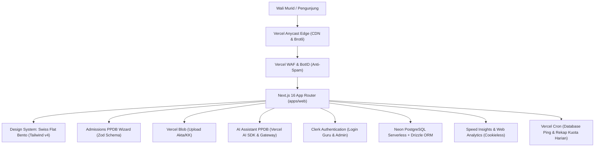

# Roadmap Arsitektur: Fokus MVP Saat Ini & Katalog Fitur Masa Depan
# Al-Birru School Information System (`albirru-sis`)

**Status Dokumen:** Disetujui & Menjadi Rujukan Resmi Tim  
**Filosofi Pengembangan:** *Simplicity First, High-Performance MVP, Zero Runaway Cost ($0), Infrastructure-Ready*  
**Terakhir Diperbarui:** 14 Oktober 2026  

---

## 1. Prinsip MVP SD Al-Birru (Kebutuhan Saat Ini)

Saat ini SD Al-Birru berfokus pada **tahap awal operasional (Fase MVP - Minimum Viable Product)**. Kebutuhan sistem dirancang ramping, berkecepatan tinggi, dan tidak rumit (*lean & clean*):

1. **Skala Pendaftaran Awal:** Target pendaftaran Gelombang 1 adalah 1–2 rombel (maksimal 30 santri dengan rasio guru:murid ideal 1:15).
2. **Tanpa Biaya Transaksi Awal ($0):** Pendaftaran digratiskan, formulir ringkas, tanpa integrasi payment gateway berbayar.
3. **Kualitas Kelas Dunia (Tier-1 Standard):** Mengutamakan kecepatan peramban (Lighthouse 100/100), aksesibilitas WCAG 2.1 AA, antarmuka Flat Swiss Bento yang bersih, dan perlindungan privasi santri (UU PDP No. 27/2022).
4. **Tanpa Beban Pemeliharaan Server:** Menghindari sistem yang terlalu kompleks (seperti klaster microservices atau websocket berkelanjutan) agar tim sekolah dapat fokus melayani calon wali murid.

---

## 2. Inventaris Fitur MVP yang Sudah Aktif & Berjalan di Produksi (:white_check_mark: Sudah)

Seluruh modul di bawah ini telah terpasang, teruji oleh rangkaian tes otomatis (71 Vitest tests), dan beroperasi penuh tanpa biaya server:

| Modul / Fitur | Lokasi Kode di Monorepo | Peran di Fase MVP |
| :--- | :--- | :--- |
| **Framework Full-Stack** | `apps/web/`, `apps/app/` | Next.js 16 (React 19) dengan React Server Components (RSC) dan Server Actions. |
| **Design System** | `packages/design-system/` | 63 komponen flat bento shadcn/ui tanpa gradien dan tanpa bayangan (*zero shadow/zero radius*). |
| **Formulir PPDB & Validasi** | `apps/web/src/app/(public)/admissions/` | Formulir multi-step wizard dengan validasi runtime skema Zod ketat. |
| **Keamanan & Bot Protection** | `apps/web/src/lib/security/bot-id.ts` | Vercel BotID reputasi request (`x-vercel-bot-score`) + Turnstile token. |
| **Penyimpanan Berkas** | `apps/web/src/lib/storage/blob.ts` | Upload dokumen Akta Kelahiran dan Kartu Keluarga langsung ke `@vercel/blob` via presigned URL. |
| **Asisten Chatbot PPDB** | `apps/web/src/app/api/chat/route.ts` | Layanan tanya jawab informasi PPDB 24/7 menggunakan Vercel AI SDK dan caching semantik. |
| **Basis Data Relasional** | `packages/database/src/schema/` | Drizzle ORM + Neon PostgreSQL Serverless dengan UUIDv7 dan audit trail terpadu. |
| **Autentikasi Pengguna** | `apps/web/src/middleware.ts` | Clerk Auth untuk manajemen akun guru, staf TU, dan kepala sekolah. |
| **Otomasi Pemeliharaan** | `apps/web/src/app/api/cron/` | Vercel Cron jobs: pemanasan database (23:00 UTC) dan rekap kuota pendaftar (01:00 UTC). |
| **Pemantauan Performa** | `apps/web/src/app/layout.tsx` | `@vercel/speed-insights` dan `@vercel/analytics` untuk skor Web Vitals nyata. |
| **Feature Flags Dinamis** | `apps/web/src/flags.ts` | `@vercel/flags` untuk mengontrol pembukaan gelombang pendaftaran secara instan. |

---

## 3. Katalog Fitur Cadangan untuk Masa Depan (:hourglass_flowing_sand: Siap Diaktifkan Saat Skala Bertambah)

Daftar ini disimpan sebagai **referensi siap pakai**. Seluruh fitur di bawah ini telah terverifikasi kompatibel dengan monorepo Al-Birru, tidak memerlukan biaya bulanan, dan baru akan diaktifkan ketika kebutuhan sekolah sudah memenuhi indikator pemicunya (*trigger condition*):

### A. Komunikasi & Otomasi Panitia

| Fitur / Modul | Sumber Spesifikasi | Pemicu Kebutuhan (*Trigger*) | Estimasi Biaya | Catatan Arsitektur |
| :--- | :--- | :--- | :---: | :--- |
| **Outbound Webhook Notifikasi WA / Telegram** | Next-Forge: `packages/webhooks/outbound` | Saat panitia PPDB membutuhkan ringkasan pendaftar baru yang langsung berdering di HP tanpa harus membuka dashboard laptop. | **Rp 0** *(Gratis via Telegram Bot API / Webhook)* | Cukup menambahkan handler dispatch di Server Action `admissions` ke endpoint Telegram/WA. |
| **Antrean Email Asinkron (`@vercel/queues`)** | Vercel Docs: `Run agents and backends > Queues` | Saat pendaftar melebihi 50 pendaftar per hari untuk mencegah pembatasan laju (*rate limit*) pengiriman email SMTP. | **Rp 0** *(Gratis via Upstash QStash 15k pesan/bln)* | Mengantrekan pengiriman PDF bukti tanda terima dan jadwal observasi di latar belakang. |

### B. Finansial & Administrasi Syariah

| Fitur / Modul | Sumber Spesifikasi | Pemicu Kebutuhan (*Trigger*) | Estimasi Biaya | Catatan Arsitektur |
| :--- | :--- | :--- | :---: | :--- |
| **Payment Gateway Syariah (BSI & QRIS)** | Next-Forge: `packages/payments` | Saat pendaftaran masuk ke Gelombang 2 berbayar atau saat penagihan SPP bulanan/seragam santri dimulai. | **Rp 0 biaya langganan** *(MDR 0%–0.3% per transaksi sukses)* | Menggunakan Midtrans/Xendit Sandbox terlebih dahulu; menolak Stripe karena biaya kartu kredit luar negeri tinggi. |

### C. Inovasi Akademik & Kurikulum Tahfidz

| Fitur / Modul | Sumber Spesifikasi | Pemicu Kebutuhan (*Trigger*) | Estimasi Biaya | Catatan Arsitektur |
| :--- | :--- | :--- | :---: | :--- |
| **AI Voice Tahfidz (Pengenalan Suara Hafalan)** | Vercel Docs: `Build AI apps > Modalities > Speech` | Saat santri mulai program mandiri setoran hafalan Juz 30 dari rumah sebelum diuji ustadz/ustadzah. | **Rp 0** *(Memakai Web Speech API peramban)* | Evaluasi pelafalan ayat diproses langsung di mikrofon browser santri tanpa membebani server sekolah. |
| **Tanda Tangan Digital Rapor & Ijazah (KMS)** | Vercel Docs: `Secure and govern > KMS` | Menjelang akhir semester saat pembagian e-Rapor atau wisuda kelulusan angkatan pertama. | **Rp 0** *(Kriptografi `node:crypto` + QR Verifikasi)* | Menghasilkan tanda tangan digital anti-pemalsuan dengan tautan verifikasi publik `/verify/[id]`. |
| **Junior Coding Lab (Vercel Sandbox)** | Vercel Platform: `Tools > Sandbox` | Saat sekolah meluncurkan ekstrakurikuler sains, robotika, dan dasar pemrograman komputer santri. | **Rp 0** *(Client-side WebContainer / Iframe Sandbox)* | Santri dapat menjalankan kode HTML/JS dasar di peramban tanpa risiko keamanan pada server sekolah. |

### D. Tata Kelola Lembaga Lanjutan

| Fitur / Modul | Sumber Spesifikasi | Pemicu Kebutuhan (*Trigger*) | Estimasi Biaya | Catatan Arsitektur |
| :--- | :--- | :--- | :---: | :--- |
| **Jembatan Sinkronisasi Dapodik (Vercel Connect)** | Vercel Docs: `Build AI apps > Connect` | Saat yayasan diwajibkan menyinkronkan data pendaftaran ke server tertutup Kemenag/Kemendikbud secara otomatis. | **Rp 0** *(Private secure bridge)* | Penghubung zero-trust antara database cloud Al-Birru dengan server pangkalan data lokal. |
| **Multi-Tenant Platform Subdomain** | Vercel Docs: `Ship and scale > Platforms` | Jika Yayasan Al-Birru membuka unit cabang sekolah baru di kota lain (misal: `bogor.albirru.sch.id`). | Tergantung paket | Subdomain dinamis otomatis per cabang sekolah di bawah satu induk monorepo. |

---

## 4. Dokumen Rujukan Terperinci

Seluruh audit rinci baris demi baris dari masing-masing spesifikasi resmi dapat dilihat pada dokumen pendukung berikut:
1. [`docs/next-forge-audit.md`](file:///d:/albirru-school-management-monorepo/docs/next-forge-audit.md) — Audit 90 modul resmi Next-Forge.
2. [`docs/vercel-services-catalog.md`](file:///d:/albirru-school-management-monorepo/docs/vercel-services-catalog.md) — Audit 80 fitur direktori platform Vercel.
3. [`docs/vercel-docs-audit.md`](file:///d:/albirru-school-management-monorepo/docs/vercel-docs-audit.md) — Audit hierarki menu navigasi dan sub-navigasi dokumentasi resmi Vercel.

---

## 5. Ringkasan Sikap Tim Rekayasa

> **"Kebutuhan saat ini dijaga tetap sederhana, terarah, dan berkualitas tinggi (MVP Unggul). Seluruh potensi ekspansi masa depan telah tercatat rapi di katalog ini sehingga dapat diaktifkan secara instan kapan pun yayasan siap berekspansi, tanpa risiko kesalahan arsitektur dan tanpa biaya tak terduga."**
