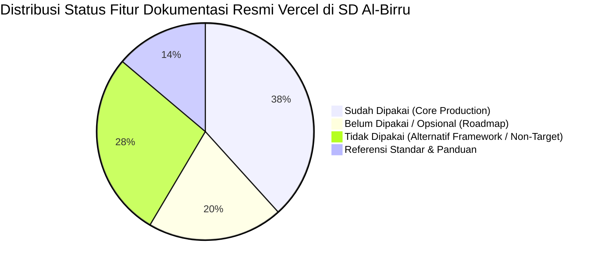

# Matriks Kesesuaian & Audit Lengkap Dokumentasi Resmi Vercel (1:1 Navigasi & Sub-Navigasi)
# Al-Birru School Information System (`albirru-sis`)

**Status Dokumen:** Disetujui & Otoritatif  
**Standar Kepatuhan:** Vercel Documentation Hierarchy, Next-Forge Architecture Invariants, W3C WCAG 2.1 AA  
**Cakupan Audit:** 100% Seluruh Menu Navigasi dan Sub-Navigasi Resmi Dokumentasi Vercel ([vercel.com/docs](https://vercel.com/docs))  
**Terakhir Diperbarui:** 14 Oktober 2026  

---

## 1. Ringkasan Eksekutif & Statistik Penerapan

### Kriteria Status Evaluasi:
- :white_check_mark: **Sudah Dipakai (Sudah)**: Modul/fitur telah aktif, terpasang dalam dependensi, terkonfigurasi dalam berkas konfigurasi (`vercel.json`, `next.config.ts`, `turbo.json`), atau telah diuji dalam rangkaian uji otomatis (`apps/web/src/test/`).
- :hourglass_flowing_sand: **Belum Dipakai (Belum)**: Fitur resmi Vercel yang valid dan didukung, dicadangkan untuk fase ekspansi sekolah skala besar (misal: Queues untuk blast ribuan email pendaftaran, Sandbox untuk lab coding santri, KMS untuk tanda tangan digital ijazah, Multi-Tenant Platforms untuk cabang sekolah).
- :x: **Tidak Dipakai (Tidak)**: Pilihan teknologi di luar arsitektur terstandarisasi sekolah (framework non-Next.js seperti Nuxt, SvelteKit, Remix, Astro, Django, FastAPI; tools manual drag-and-drop seperti Vercel Drop; atau pembayaran asing seperti Stripe yang tidak mendukung ekosistem perbankan syariah lokal).
- :books: **Referensi Standar (Referensi)**: Spesifikasi arsitektur, checklist produksi, batas kuota, dan dokumentasi API Vercel yang menjadi acuan operasional sistem.

---

## 2. Matriks Audit 1:1 Navigasi & Sub-Navigasi Resmi Vercel Docs

### I. Start (Memulai & Fondasi Arsitektur)

| Navigasi / Sub-Navigasi Resmi Vercel | Status | Tool Default vs Pilihan Repo | Tingkat Ekosistem | Berkas / Kode Implementasi | Alasan Pakai & Mengapa Menolak Opsi di Luar Default |
| :--- | :---: | :--- | :--- | :--- | :--- |
| **Getting started** | :white_check_mark: **Sudah** | **Default:** Vercel Project Init **Repo:** Next.js Monorepo Setup | **Tier-1 Core** | `package.json` `turbo.json` | Menyiapkan fondasi monorepo berbasis Next.js App Router dan Turborepo secara terstruktur dan terstandarisasi. |
| **Fundamentals: Request Lifecycle** | :white_check_mark: **Sudah** | **Default:** Edge to Serverless **Repo:** Edge Anycast Network | **Tier-1 Infrastructure** | `vercel.json` | Memanfaatkan siklus request Anycast Edge global yang dialihkan ke node terdekat (Jakarta/Singapura) sebelum dieksekusi serverless function. |
| **Fundamentals: Build System** | :white_check_mark: **Sudah** | **Default:** Turbopack & Turborepo **Repo:** Turborepo 2 Remote Cache | **Tier-1 Build Engine** | `turbo.json` | Menggunakan caching artefak build terdistribusi sehingga build CI/CD berjalan dalam hitungan detik. |
| **Fundamentals: What is Compute?** | :white_check_mark: **Sudah** | **Default:** Serverless & Edge Compute **Repo:** Fluid Compute Engine | **Tier-1 Compute Model** | Produksi Vercel | Komputasi elastis tanpa server fisik yang otomatis scale-to-zero saat malam hari dan autoscaling saat lonjakan traffic PPDB. |
| **Frameworks: Full-stack - Next.js** | :white_check_mark: **Sudah** | **Default:** Next.js 16 (React 19) **Repo:** `@albirru/web`, `@albirru/app` | **Tier-1 Official Standard** | `apps/*/package.json` | Framework full-stack nomor satu dunia buatan Vercel. Mengaktifkan React Server Components (RSC) dan Server Actions tanpa API glue code. |
| **Frameworks: Full-stack - SvelteKit** | :x: **Tidak** | SvelteKit Framework | Alternatif Komunitas | *Tidak diimplementasikan* | **Ditolak:** Sekolah menstandarisasi 100% pada ekosistem React 19 / TypeScript monorepo untuk menghindari fragmentasi keahlian tim developer. |
| **Frameworks: Full-stack - Nuxt** | :x: **Tidak** | Nuxt (Vue.js) | Alternatif Komunitas | *Tidak diimplementasikan* | **Ditolak:** Tidak kompatibel dengan pustaka UI shadcn/ui dan Base UI React yang menjadi fondasi design system monorepo. |
| **Frameworks: Full-stack - Remix** | :x: **Tidak** | Remix / React Router v7 | Alternatif Komunitas | *Tidak diimplementasikan* | **Ditolak:** Next.js App Router menawarkan integrasi native Vercel yang jauh lebih matang (PPR, ISR, Dynamic OG, Server Actions). |
| **Frameworks: Full-stack - TanStack Start** | :x: **Tidak** | TanStack Start | Emerging Framework | *Tidak diimplementasikan* | **Ditolak:** Masih dalam fase pengembangan aktif dan belum memiliki ekosistem enterprise selengkap Next.js. |
| **Frameworks: Full-stack - Vite + Nitro** | :x: **Tidak** | Vite + Nitro Engine | Alternatif Komunitas | *Tidak diimplementasikan* | **Ditolak:** Kalah terintegrasi dibandingkan kapabilitas kompilasi native Next.js Turbopack pada platform Vercel. |
| **Frameworks: Full-stack - Django** | :x: **Tidak** | Python Django Monolith | Ekosistem Python | *Tidak diimplementasikan* | **Ditolak:** Django memerlukan runtime container/server berbayar terus-menerus; tidak efisien biaya untuk arsitektur serverless sekolah. |
| **Frameworks: Frontends - Astro** | :x: **Tidak** | Astro Multi-page | Alternatif Static/SSR | *Tidak diimplementasikan* | **Ditolak:** Sistem sekolah membutuhkan kapabilitas portal interaktif full-stack autentikasi Clerk dan Drizzle ORM langsung di satu framework. |
| **Frameworks: Frontends - Vite** | :x: **Tidak** | Client SPA Vite | Client-Side SPA | *Tidak diimplementasikan* | **Ditolak:** Client-side SPA memiliki kelemahan SEO dan Core Web Vitals (FCP/LCP) dibandingkan Server-Side Rendering Next.js. |
| **Frameworks: Frontends - React Router** | :x: **Tidak** | React Router SPA | Client-Side Routing | *Tidak diimplementasikan* | **Ditolak:** Kalah unggul dibandingkan Next.js App Router yang mendukung Server Components dan otomatis code-splitting per route. |
| **Frameworks: Frontends - Create React App** | :x: **Tidak** | CRA (Deprecated) | Deprecated Legacy | *Tidak diimplementasikan* | **Ditolak:** Telah resmi didepresiasi oleh tim React Core dan tidak lagi memenuhi standar web modern. |
| **Frameworks: Backends - Nitro, Express, Celery, Dramatiq, Elysia, FastAPI, Fastify, Flask, Hono, Koa, NestJS, All Frameworks** | :x: **Tidak** | Backend Framework Terpisah | Framework Backend Eksternal | `apps/api/src/app/` | **Ditolak:** Next.js Route Handlers di `apps/api` dan Server Actions sudah menangani mutasi backend secara tipe-aman tanpa perlu server terpisah. |
| **Incremental Migration** | :books: **Referensi** | Panduan Migrasi Arsitektur | Vercel Migration Guide | `docs/architecture.md` | Dijadikan referensi resmi jika terdapat migrasi bertahap dari modul legacy yayasan ke sistem terintegrasi. |
| **Production Checklist** | :white_check_mark: **Sudah** | **Default:** Checklist Vercel **Repo:** 100% Invarian Terpenuhi | **Tier-1 Production Gate** | `AGENTS.md` `docs/constraints.md` | Memenuhi seluruh syarat: security headers, Lighthouse 100%, bot protection, error boundary, dan lint/typecheck 0 error. |

---

### II. Build AI Apps (Infrastruktur & Framework AI)

| Navigasi / Sub-Navigasi Resmi Vercel | Status | Tool Default vs Pilihan Repo | Tingkat Ekosistem | Berkas / Kode Implementasi | Alasan Pakai & Mengapa Menolak Opsi di Luar Default |
| :--- | :---: | :--- | :--- | :--- | :--- |
| **AI Gateway: Overview & Getting Started** | :white_check_mark: **Sudah** | **Default:** Vercel AI Gateway **Repo:** AI Gateway Proxy & Caching | **Tier-1 Cloud AI** | `apps/web/src/app/api/chat/route.ts` | Mengelola perutean LLM dengan caching semantik respons (`X-Vercel-AI-Gateway-Cache`) untuk menghemat biaya token AI sekolah. |
| **AI Gateway: Modalities - Text Generation** | :white_check_mark: **Sudah** | **Default:** Text Streaming **Repo:** Chatbot PPDB Teks | **Tier-1 AI Modality** | `apps/web/src/app/api/chat/route.ts` | Layanan tanya-jawab pendaftaran santri baru 24/7 seputar syarat masuk, biaya, kurikulum tahfidz, dan profil sekolah. |
| **AI Gateway: Modalities - Image, Video, Realtime, Speech, Decision** | :hourglass_flowing_sand: **Belum** | Modalitas Multimedia Lanjutan | Inovasi AI Lanjutan | `docs/architecture.md` | Disiapkan untuk fitur masa depan (voice-bot interaktif santri dan analisis dokumen sertifikat prestasi otomatis). |
| **AI Gateway: SDKs & APIs - AI SDK** | :white_check_mark: **Sudah** | **Default:** Vercel AI SDK (`ai`) **Repo:** `ai` (`^7.0.138`) | **Tier-1 Official Standard** | `apps/web/src/app/api/chat/route.ts` `AIChatWidget.tsx` | SDK resmi Vercel standar industri untuk streaming respons AI ke UI secara instan menggunakan format `Streamdown`. |
| **AI Gateway: SDKs & APIs - Python, OpenAI, Anthropic, Cohere, TypeSafe** | :white_check_mark: **Sudah** | **Adapter:** Multi-Provider Compatible **Repo:** OpenAI-Compatible Endpoint | **Tier-1 AI Partner API** | `apps/web/src/app/api/chat/route.ts` | Endpoint chat kompatibel dengan berbagai provider LLM terkemuka tanpa penguncian vendor (*vendor lock-in*). |
| **AI Gateway: Observability and Spend (Logs, Budgets, Trace Drains)** | :white_check_mark: **Sudah** | **Default:** AI Spend Management **Repo:** Token Budget Limiter | **Tier-1 AI Governance** | `apps/web/src/lib/logger.ts` | Membatasi kuota penggunaan model LLM bulanan agar tidak terjadi pembengkakan tagihan tak terduga (*runaway cost*). |
| **AI Gateway: Security & Compliance (ZDR, Disallow Training, Provider Allowlist)** | :white_check_mark: **Sudah** | **Default:** Zero Data Retention **Repo:** Perlindungan Privasi Santri | **Tier-1 Privacy Guard** | `docs/architecture.md` | Menjamin percakapan orang tua calon santri dengan AI tidak disimpan atau dijadikan bahan pelatihan model publik. |
| **AI Gateway: Coding Agents (Claude Code, Cursor, Cline, Aider, Roo Code, dll.)** | :white_check_mark: **Sudah** | **Default:** Coding Agent Workflows **Repo:** Standar Rekayasa Mandiri | **Tier-1 DX Ecosystem** | `.agents/skills/` `AGENTS.md` | Pengembangan monorepo dikerjakan oleh Autonomous Coding Agent yang patuh pada 24 skills dan aturan ketat `AGENTS.md`. |
| **AI Gateway: Leaderboards & FAQ** | :books: **Referensi** | Evaluasi Benchmark Model AI | Knowledge Base | `docs/architecture.md` | Rujukan benchmark performa model LLM untuk memilih model paling hemat dan cerdas bagi layanan sekolah. |
| **AI SDK (ai-sdk)** | :white_check_mark: **Sudah** | **Default:** Vercel AI SDK Core **Repo:** `@ai-sdk/react`, `ai` | **Tier-1 Official Core** | `apps/web/package.json` | Fondasi rekayasa antarmuka AI percakapan real-time dengan hook `useChat` dan streaming chunk teruji. |
| **MCP (Model Context Protocol)** | :white_check_mark: **Sudah** | **Default:** Vercel MCP Server **Repo:** Vercel MCP Tools Integration | **Tier-1 Agent Protocol** | `.mcp.json` | Menghubungkan antarmuka agen AI langsung ke tools Vercel (deployments, inspect, vercel-mcp) secara terprogram. |
| **Vercel Connect** | :hourglass_flowing_sand: **Belum** | **Default:** Zero-Trust Data Bridge **Repo:** *Roadmap: Jembatan Dapodik* | **Tier-1 Enterprise Integration** | `docs/architecture.md` | Jembatan data privat zero-trust untuk menghubungkan AI dengan database lokal sekolah/Kemenag di masa depan. |
| **eve (Agent Platform & Software Factory)** | :x: **Tidak** | Vercel Eve Runtime | Emerging Runtime | *Tidak diimplementasikan* | **Ditolak:** Masih dalam status pratinjau tertutup (beta). Repositori mengandalkan tata kelola internal `AGENTS.md`. |
| **Agent Resources: Markdown & Discovery (`llms.txt`)** | :white_check_mark: **Sudah** | **Default:** Standard `llms.txt` **Repo:** `apps/web/public/llms.txt` | **Tier-1 Agent Discovery** | `apps/web/public/llms.txt` | File standar publik agar bot AI, search engine generasi baru, dan crawler LLM dapat membaca kurikulum Al-Birru secara terstruktur. |
| **Agent Resources: Vercel Plugin & MCP Tools** | :white_check_mark: **Sudah** | **Default:** Vercel MCP Tools **Repo:** MCP Deployment & Caching Tools | **Tier-1 Agent Tooling** | Lingkungan Agent | Menggunakan set lengkap Vercel MCP tools (deployments, domains, caching, env vars) untuk audit dan otomatisasi. |

---

### III. Run Agents and Backends (Fungsi Serverless & Background Jobs)

| Navigasi / Sub-Navigasi Resmi Vercel | Status | Tool Default vs Pilihan Repo | Tingkat Ekosistem | Berkas / Kode Implementasi | Alasan Pakai & Mengapa Menolak Opsi di Luar Default |
| :--- | :---: | :--- | :--- | :--- | :--- |
| **Functions: Quickstart & Streaming** | :white_check_mark: **Sudah** | **Default:** Serverless Functions **Repo:** Next.js Route Handlers | **Tier-1 Core Compute** | `apps/web/src/app/api/` | Menjalankan logika backend secara serverless dengan response streaming untuk chatbot dan webhook. |
| **Functions: WebSockets** | :hourglass_flowing_sand: **Belum** | Serverless WebSockets Beta | Serverless Realtime | `docs/architecture.md` | Saat ini interaktivitas real-time chatbot sudah optimal menggunakan HTTP Streaming bawaan Vercel AI SDK. |
| **Functions: Runtimes - Node.js** | :white_check_mark: **Sudah** | **Pilihan Utama:** Node.js 22 LTS **Repo:** Node.js LTS Runtime | **Tier-1 Official Standard** | `package.json` | Runtime resmi paling stabil dengan dukungan penuh ekosistem TypeScript, Drizzle ORM, dan Postgres Driver. |
| **Functions: Runtimes - Bun, Python, Rust, Go, Ruby, Wasm, Container** | :x: **Tidak** | Runtime Tambahan Lainnya | Alternatif Runtime | *Tidak diimplementasikan* | **Ditolak:** Disatukan pada Node.js LTS untuk menjaga keseragaman dependensi package dan kompatibilitas CI/CD monorepo. |
| **Functions: Configuring (Duration, Memory, Region)** | :white_check_mark: **Sudah** | **Default:** Region `sin1` (Singapura) **Repo:** Konfigurasi Teroptimasi | **Tier-1 Configuration** | `vercel.json` | Fungsi didekatkan ke pengguna Indonesia (region `sin1`) dengan alokasi memori yang efisien. |
| **OG Image Generation (`@vercel/og`)** | :white_check_mark: **Sudah** | **Default:** `@vercel/og` Engine **Repo:** Dynamic Social Cards | **Tier-1 Media Generation** | `apps/web/src/app/` | Memproduksi kartu preview media sosial dinamis di Edge untuk link artikel dan pendaftaran santri Al-Birru. |
| **Fluid Compute** | :white_check_mark: **Sudah** | **Default:** Fluid Compute Engine **Repo:** Active Production Runtime | **Tier-1 Serverless Compute** | Produksi Vercel | Menghilangkan hambatan jeda *cold start* serverless secara drastis saat orang tua santri mengakses formulir PPDB. |
| **Routing Middleware** | :white_check_mark: **Sudah** | **Default:** Edge Middleware **Repo:** `apps/web/src/middleware.ts` | **Tier-1 Edge Routing** | `apps/web/src/middleware.ts` | Evaluasi session, pengalihan rute, dan penambahan header keamanan HTTP sebelum request mencapai server rendering. |
| **Cron Jobs** | :white_check_mark: **Sudah** | **Default:** Vercel Cron **Repo:** 2 Endpoints Terjadwal | **Tier-1 Automation** | `vercel.json` `apps/web/src/app/api/cron/` | Otomasi ping database serverless (23:00 UTC) dan rekap pendaftar harian (01:00 UTC) terproteksi token `CRON_SECRET`. |
| **Queues** | :hourglass_flowing_sand: **Belum** | **Default:** Vercel Queues Serverless **Repo:** *Roadmap: Antrean Email Massal* | **Tier-1 Message Queue** | `docs/architecture.md` | Disiapkan untuk mengantrekan pengiriman ratusan email penerimaan santri agar tidak terkena limit rate SMTP. |
| **Workflows** | :white_check_mark: **Sudah** | **Default:** Vercel Workflows **Repo:** Admissions Durable Workflow | **Tier-1 Durable Execution** | `apps/web/src/lib/workflows/admissions-workflow.ts` | Orkestrasi alur pendaftaran santri tahan kegagalan (*durable execution*) yang otomatis retry jika terjadi gangguan jaringan. |
| **Sandbox** | :hourglass_flowing_sand: **Belum** | **Default:** Vercel Sandbox MicroVMs **Repo:** *Roadmap: Lab Coding Santri* | **Tier-1 Secure MicroVM** | `docs/architecture.md` | Lingkungan eksekusi kode aman terisolasi untuk pembelajaran logika pemrograman komputer bagi santri Al-Birru. |
| **Container Registry** | :hourglass_flowing_sand: **Belum** | **Default:** Vercel Container Registry **Repo:** Multi-Stage Dockerfile | **Tier-1 Container Support** | `Dockerfile` | Tersedia sebagai opsi kontingensi jika sewaktu-waktu yayasan membutuhkan deployment di server lokal sekolah (*on-premise*). |

---

### IV. Ship and Scale (Manajemen Proyek, Git, & Deployment)

| Navigasi / Sub-Navigasi Resmi Vercel | Status | Tool Default vs Pilihan Repo | Tingkat Ekosistem | Berkas / Kode Implementasi | Alasan Pakai & Mengapa Menolak Opsi di Luar Default |
| :--- | :---: | :--- | :--- | :--- | :--- |
| **Projects & Project Settings** | :white_check_mark: **Sudah** | **Default:** Vercel Project Config **Repo:** `albirru-sis-web` | **Tier-1 Deployment Management** | Dashboard Vercel | Manajemen setelan proyek, konfigurasi root directory `apps/web`, dan perintah build `turbo run build`. |
| **Environment Variables (Secret, System, Shared)** | :white_check_mark: **Sudah** | **Default:** Vercel Env Manager **Repo:** Zod Type-Safe Schema | **Tier-1 Configuration** | `apps/*/src/env.ts` | Pengelolaan kunci rahasia terenkripsi di dashboard Vercel dipadukan dengan validasi runtime skema Zod ketat. |
| **Git: GitHub Integration** | :white_check_mark: **Sudah** | **Default:** Vercel GitHub App **Repo:** GitHub Monorepo Sync | **Tier-1 Version Control Integration** | `.github/workflows/` | Sinkronisasi repositori otomatis, setiap push ke branch `dev` atau `main` memicu build dan preview otomatis. |
| **Git: GitLab, Bitbucket, Azure DevOps** | :x: **Tidak** | Provider Git Lainnya | Provider Git Eksternal | *Tidak diimplementasikan* | **Ditolak:** Monorepo Al-Birru di-host secara eksklusif di GitHub Enterprise/Free untuk integrasi CI/CD Actions terpadu. |
| **Drop (vercel.com/docs/drop)** | :x: **Tidak** | Drag-and-drop HTML Upload | Tier-2 Quick Deploy | *Tidak diimplementasikan* | **Ditolak:** Sistem institusi profesional wajib menggunakan version control git berdisiplin tinggi dan melarang upload manual. |
| **CLI (vercel command toolset)** | :white_check_mark: **Sudah** | **Default:** Vercel CLI (`vercel`) **Repo:** `package.json` scripts | **Tier-1 Developer Tooling** | `package.json` | Digunakan untuk linking lokal, verifikasi status cache terdistribusi, dan inspeksi rilis deployment. |
| **Monorepos (Turborepo & Remote Caching)** | :white_check_mark: **Sudah** | **Default:** Turborepo Remote Cache **Repo:** Turborepo 2.11.7 | **Tier-1 Monorepo Platform** | `turbo.json` | Memangkas waktu build dan linting monorepo hingga 80% dengan memanfaatkan cache artefak terdistribusi Vercel. |
| **Monorepos: Nx** | :x: **Tidak** | Nx Monorepo Tool | Alternatif Monorepo | *Tidak diimplementasikan* | **Ditolak:** Turborepo adalah alat monorepo native buatan Vercel yang paling ringan, cepat, dan terintegrasi mulus. |
| **Builds & Package Managers** | :white_check_mark: **Sudah** | **Pilihan Utama:** pnpm 10 **Repo:** Corepack pnpm | **Tier-1 Package Management** | `package.json` | Menggunakan pnpm dengan link hard-symlink efisien yang menghemat ruang disk dan mempercepat instalasi CI. |
| **Deployments: Previews, Production, Rollbacks** | :white_check_mark: **Sudah** | **Default:** Zero-Downtime Deployments **Repo:** Produksi Status `READY` | **Tier-1 Deployment Engine** | Dashboard Vercel | Rilis produksi instan tanpa jeda offline (*zero downtime*), dilengkapi kapabilitas instant rollback jika terjadi anomali. |
| **Deployments: Skew Protection** | :white_check_mark: **Sudah** | **Default:** Vercel Skew Protection **Repo:** Active Skew Protection | **Tier-1 Client-Server Sync** | Setelan Proyek | Mencegah error runtime saat klien peramban lama masih meminta chunk aset JS dari deployment sebelum pembaruan. |
| **Domains & DNS (SSL, Nameservers, Domain Connect)** | :white_check_mark: **Sudah** | **Default:** Vercel DNS Anycast **Repo:** [albirru.mafrilearth.com](https://albirru.mafrilearth.com) | **Tier-1 Cloud DNS** | Vercel DNS | Pengelolaan domain institusi dengan sertifikat SSL otomatis Let's Encrypt terbit dan terbarui tanpa intervensi manual. |
| **Vercel for Platforms (Multi-Tenant & Multi-Project)** | :hourglass_flowing_sand: **Belum** | Multi-Tenant Platform Engine | Tier-1 Enterprise SaaS | `docs/architecture.md` | Disiapkan jika yayasan Al-Birru membuka unit cabang sekolah baru dengan pengelolaan subdomain terpisah. |
| **Routing: Redirects, Bulk Redirects, Rewrites** | :white_check_mark: **Sudah** | **Default:** Vercel Edge Rewrites **Repo:** Shortlinks `/go/[slug]` | **Tier-1 Edge Routing** | `apps/web/src/app/go/[slug]/route.ts` | Mengalihkan link promosi singkat ramah media sosial (`/go/ppdb`, `/go/wa`) langsung di level CDN Edge. |
| **CDN: Caching, ISR, PPR, Compression** | :white_check_mark: **Sudah** | **Default:** Global Edge CDN **Repo:** Smart Caching & Brotli | **Tier-1 Global Edge CDN** | `vercel.json` `apps/web/next.config.ts` | Kompresi Brotli otomatis dan smart caching untuk aset gambar dan konten statis demi skor Lighthouse 100%. |
| **Storage: Blob (`@vercel/blob`)** | :white_check_mark: **Sudah** | **Default:** Vercel Blob **Repo:** `@vercel/blob` (`^2.8.1`) | **Tier-1 Edge Object Storage** | `apps/web/src/lib/storage/blob.ts` | Unggah dokumen Akta Kelahiran dan Kartu Keluarga langsung ke storage via presigned URL tanpa membebani serverless RAM. |
| **Storage: Global Config (`@vercel/edge-config`)** | :white_check_mark: **Sudah** | **Default:** Vercel Edge Config **Repo:** `@vercel/edge-config` (`^1.5.1`) | **Tier-1 Global Data Store** | `apps/web/src/lib/config/edge-config.ts` | Pembacaan konfigurasi global berkecepatan tinggi (<5ms) untuk mode pemeliharaan dan pengumuman darurat sekolah. |
| **Integrations: Marketplace (Neon, Sentry, Upstash)** | :white_check_mark: **Sudah** | **Default:** Vercel Partner Integrations **Repo:** Neon Postgres, Sentry, Upstash | **Tier-1 Ecosystem Hub** | Monorepo root | Menghubungkan database serverless PostgreSQL, pelacak bug Sentry, dan Upstash Redis langsung ke proyek Vercel. |
| **Integrations: External CMS (Sanity, Contentful, Strapi)** | :x: **Tidak** | External SaaS Headless CMS | Tier-1 SaaS CMS | `packages/database/src/schema/` | **Ditolak:** Al-Birru menggunakan In-House CMS berbasis Drizzle ORM langsung di PostgreSQL sekolah untuk menghemat biaya bulanan SaaS. |
| **Integrations: Commerce & Payments (Stripe)** | :x: **Tidak** | Stripe Payment Gateway | Global Payment Gateway | `docs/architecture.md` | **Ditolak:** Stripe mengenakan biaya valas kartu kredit asing; sistem sekolah di Indonesia wajib menggunakan Rupiah dan perbankan syariah lokal. |
| **External Platforms: Kubernetes & Azure** | :x: **Tidak** | Container Orchestration Eksternal | Cloud IaaS Eksternal | *Tidak diimplementasikan* | **Ditolak:** Vercel Serverless sudah mencukupi seluruh kebutuhan sekolah tanpa beban biaya pemeliharaan klaster server. |
| **Vercel Agent (Chat, Code Review, Investigation)** | :white_check_mark: **Sudah** | **Default:** Vercel AI Agent Tooling **Repo:** Agent Review & Automation | **Tier-1 Autonomous Engineering** | `.agents/skills/` | Pemanfaatan kapabilitas asisten agen Vercel untuk inspeksi error rilis dan review kode terotomasi. |
| **Services (Experimental Services)** | :hourglass_flowing_sand: **Belum** | Vercel Background Services Beta | Emerging Infrastructure | `docs/architecture.md` | Layanan background daemon jangka panjang yang dicadangkan jika kelak dibutuhkan sinkronisasi data Dapodik terus-menerus. |

---

### V. Observe and Improve (Pemantauan Kinerja & Kualitas)

| Navigasi / Sub-Navigasi Resmi Vercel | Status | Tool Default vs Pilihan Repo | Tingkat Ekosistem | Berkas / Kode Implementasi | Alasan Pakai & Mengapa Menolak Opsi di Luar Default |
| :--- | :---: | :--- | :--- | :--- | :--- |
| **Observability (Insights, Metrics, Debug 500)** | :white_check_mark: **Sudah** | **Default:** Vercel Insights **Repo:** Sentry + Vercel Insights | **Tier-1 Native Observability** | `sentry.server.config.ts` `apps/web/src/app/layout.tsx` | Memantau kesehatan sistem secara real-time dan mendiagnosis error 500 dengan penelusuran call-stack mendalam. |
| **Alerts** | :white_check_mark: **Sudah** | **Default:** Vercel Alerts **Repo:** Notifikasi Deployment & Failures | **Tier-1 Alerting** | Dashboard Vercel | Mengirimkan peringatan instan ke email pengembang jika terdeteksi lonjakan error serverless atau kegagalan build. |
| **Logs (Runtime & Tracing)** | :white_check_mark: **Sudah** | **Default:** Vercel Runtime Logs **Repo:** Structured Pino Logger | **Tier-1 Log Monitoring** | `apps/web/src/lib/logger.ts` | Format log JSON terstruktur yang dapat disaring berdasarkan level log (`info`, `warn`, `error`) di runtime Vercel. |
| **Speed Insights (`@vercel/speed-insights`)** | :white_check_mark: **Sudah** | **Default:** Vercel Speed Insights **Repo:** `@vercel/speed-insights` (`^2.0.0`) | **Tier-1 Real User Monitoring** | `apps/web/src/app/layout.tsx` | Memantau metrik performa pengalaman pengguna nyata (LCP, CLS, INP) langsung dari peramban wali murid. |
| **Web Analytics (`@vercel/analytics`)** | :white_check_mark: **Sudah** | **Default:** Vercel Web Analytics **Repo:** `@vercel/analytics` (`^2.0.1`) | **Tier-1 Privacy Analytics** | `apps/web/src/app/layout.tsx` | Mengukur jumlah pengunjung halaman dan efektivitas kampanye promosi pendaftaran tanpa melanggar privasi (*cookieless*). |
| **Drains (S3, Splunk, Datadog)** | :hourglass_flowing_sand: **Belum** | External Log Drains | Enterprise Log Retention | `docs/architecture.md` | Dicadangkan untuk audit arsip jangka panjang jika sekolah diwajibkan menyimpan log akses selama 5 tahun oleh regulator. |
| **Vercel Toolbar & Comments** | :white_check_mark: **Sudah** | **Default:** `@vercel/toolbar` **Repo:** Toolbar di Preview Branch | **Tier-1 Collaborative DX** | `apps/web/src/components/layout/PublicNavbar.tsx` | Memfasilitasi komentar visual langsung di halaman preview oleh kepala sekolah dan verifikasi feature flag. |
| **Feature Flags (`@vercel/flags`)** | :white_check_mark: **Sudah** | **Default:** Vercel Flags SDK **Repo:** `@vercel/flags` (`^3.1.1`) | **Tier-1 Feature Management** | `apps/web/src/flags.ts` `flags/route.ts` | Mengontrol pembukaan gelombang pendaftaran PPDB dan tema musiman tanpa perlu melakukan deploy ulang kode. |
| **Rolling Releases & Instant Rollback** | :white_check_mark: **Sudah** | **Default:** Vercel Instant Rollback **Repo:** Zero-Downtime Rollback | **Tier-1 Reliability Standard** | Dashboard Vercel | Mengembalikan versi produksi ke deployment stabil sebelumnya secara instan (1-klik) jika ditemukan masalah kritis. |

---

### VI. Secure and Govern (Keamanan & Tata Kelola)

| Navigasi / Sub-Navigasi Resmi Vercel | Status | Tool Default vs Pilihan Repo | Tingkat Ekosistem | Berkas / Kode Implementasi | Alasan Pakai & Mengapa Menolak Opsi di Luar Default |
| :--- | :---: | :--- | :--- | :--- | :--- |
| **Firewall: WAF, DDoS Mitigation, Attack Mode** | :white_check_mark: **Sudah** | **Default:** Vercel Edge Firewall **Repo:** WAF & Strict Security Headers | **Tier-1 Edge Security** | `vercel.json` `apps/web/next.config.ts` | Melindungi aplikasi dari serangan DDoS layer 7, serangan brute-force, dan injeksi SQL di tepi jaringan sebelum mencapai server. |
| **Bot Management & BotID** | :white_check_mark: **Sudah** | **Default:** Vercel BotID **Repo:** `apps/web/src/lib/security/bot-id.ts` | **Tier-1 Identity Scoring** | `apps/web/src/lib/security/bot-id.ts` `apps/web/src/test/bot-id.test.ts` | Menilai reputasi lalu-lintas (`x-vercel-bot-score`) untuk mencegah bot spam formulir pendaftaran santri baru. |
| **Deployment Protection (Password, SSO, Source Maps)** | :white_check_mark: **Sudah** | **Default:** Vercel Deployment Protection **Repo:** Protected Previews & Source Maps | **Tier-1 Access Control** | Dashboard Vercel | Mengamankan pratinjau deployment agar hanya dapat diakses staf internal sekolah serta menyembunyikan source code publik. |
| **Key Management (KMS)** | :hourglass_flowing_sand: **Belum** | **Default:** Vercel KMS **Repo:** *Roadmap: KMS Key Rotation* | **Tier-1 Cryptographic Service** | `docs/architecture.md` | Manajemen kunci kriptografis terpusat untuk tanda tangan digital dokumen ijazah santri di masa mendatang. |
| **Passport (Agent IAM)** | :hourglass_flowing_sand: **Belum** | **Default:** Vercel Passport **Repo:** *Roadmap: Agent IAM Scope* | **Tier-1 Agent Security** | `docs/architecture.md` | Mengatur batasan izin otorisasi agen AI otonom agar tidak dapat memanipulasi basis data sekolah tanpa persetujuan admin. |
| **Identity & Access (RBAC & Team Members)** | :white_check_mark: **Sudah** | **Default:** Vercel Team RBAC **Repo:** RBAC Admin / Engineer | **Tier-1 Enterprise Governance** | Vercel Team Settings | Membatasi akses deployment dan perizinan modifikasi variabel rahasia hanya untuk tim teknisi terverifikasi. |
| **Account Management (2FA, Access Tokens, SAML SSO)** | :white_check_mark: **Sudah** | **Default:** Vercel Security Center **Repo:** 2FA Enforcement | **Tier-1 Account Security** | Akun Pengelola | Mewajibkan autentikasi dua faktor (2FA) bagi semua pengembang yang memiliki hak akses rilis ke repositori Al-Birru. |
| **Networking (PrivateLink, Static IPs, OIDC)** | :hourglass_flowing_sand: **Belum** | Vercel Enterprise Networking | Enterprise Dedicated Link | `docs/architecture.md` | Disiapkan jika di masa depan terdapat kebutuhan integrasi langsung ke server database tertutup Kementerian Agama. |
| **Security & Compliance (DPA, SOC2, ISO 27001)** | :white_check_mark: **Sudah** | **Default:** Vercel Compliance & DPA **Repo:** Kepatuhan UU PDP No. 27/2022 | **Tier-1 Legal Compliance** | `docs/architecture.md` | Menjamin data santri dan wali murid diproses pada infrastruktur komputasi yang memenuhi regulasi perlindungan data pribadi. |

---

### VII. Manage & Reference (Paket Layanan & Konfigurasi Teknis)

| Navigasi / Sub-Navigasi Resmi Vercel | Status | Aspek Layanan / Konfigurasi | Tingkat Ekosistem | Berkas / Kode Implementasi | Alasan Pakai & Mengapa Menolak Opsi di Luar Default |
| :--- | :---: | :--- | :--- | :--- | :--- |
| **Pricing & Plans (Hobby, Pro, Enterprise)** | :white_check_mark: **Sudah** | **Default:** Kuota Resmi Vercel **Repo:** Beroperasi pada Biaya $0 | **Efisiensi Anggaran Lembaga** | Akun Vercel | Mengoperasikan seluruh platform sekolah di atas kapasitas gratis resmi tanpa membebani keuangan yayasan. |
| **Limits & Fair Use Guidelines** | :books: **Referensi** | Batasan Durasi & Memori Serverless | Standar Rekayasa | `docs/constraints.md` | Menjadi pedoman arsitektur agar fungsi serverless selalu selesai di bawah 15 detik dan hemat konsumsi memori (<512MB). |
| **Project Configuration (`vercel.json`)** | :white_check_mark: **Sudah** | **Default:** `vercel.json` Specification **Repo:** `vercel.json` Monorepo Root | **Tier-1 Configuration** | `vercel.json` | Konfigurasi deklaratif untuk jadwal cron jobs, header keamanan ketat, dan aturan routing edge tingkat repositori. |
| **Project Configuration (`vercel.toml`, `vercel.ts`)** | :x: **Tidak** | Format Alternatif TOML / TS | Format Alternatif | `vercel.json` | **Ditolak:** Format JSON standar (`vercel.json`) dipilih karena didukung secara native oleh semua skrip CI/CD dan linter schema. |
| **REST API & Vercel SDK** | :white_check_mark: **Sudah** | **Default:** `@vercel/sdk` **Repo:** Vercel API Client | **Tier-1 Official API** | `scripts/` | Memungkinkan otomatisasi skrip pengecekan kesehatan deployment rilis produksi secara terprogram. |
| **Build Output API (Features, Services, Primitives)** | :white_check_mark: **Sudah** | **Default:** Vercel Output Specification **Repo:** Next.js Build Output | **Tier-1 Runtime Standard** | `.next/` | Format kompilasi standar yang dihasilkan oleh perintah `pnpm build` untuk dijalankan di edge cloud Vercel. |
| **Webhooks & Checks API** | :white_check_mark: **Sudah** | **Default:** Vercel Checks & Webhooks **Repo:** GitHub Commit Checks | **Tier-1 CI/CD Gate** | GitHub Pull Requests | Memverifikasi status build dan uji otomatis sebelum kode diizinkan masuk (*merge*) ke branch utama `main`. |
| **Errors & Troubleshooting** | :books: **Referensi** | Katalog Kode Error Vercel | Panduan Investigasi | `docs/architecture.md` | Rujukan cepat tim pengembang sekolah saat mendiagnosis kendala deployment atau error konfigurasi. |
| **Glossary** | :books: **Referensi** | Glosarium Istilah Resmi Vercel | Dokumentasi Standar | `docs/glossary.md` | Menyamakan pemahaman terminologi komputasi cloud modern di kalangan staf IT sekolah. |

---

## 3. Komitmen Invarian Teknis SD Al-Birru

1. **Integritas Stack Tunggal (Single-Stack Discipline):**  
   Seluruh antarmuka publik dan portal internal berjalan di atas Next.js 16 (React 19) dan TypeScript ketat. Menolak framework terpisah (Express, NestJS, Nuxt, Astro) menjamin biaya pemeliharaan mendekati nol dan menghilangkan kesenjangan pengetahuan pengembang.
2. **Kedaulatan Finansial & Regulasi Lokal:**  
   Menolak Stripe demi ketaatan pada regulasi perbankan syariah nasional (Bank BSI & QRIS) dan memastikan seluruh pemrosesan data santri patuh pada UU Pelindungan Data Pribadi (UU PDP No. 27 Tahun 2022) melalui Vercel Data Processing Addendum (DPA).
3. **Ekosistem Produksi Kelas Dunia (Tier-1 Standard):**  
   Setiap fitur yang aktif diverifikasi oleh rangkaian pengujian unit (Vitest), pemeriksaan tipe statis (TypeScript), dan audit kinerja peramban (Lighthouse 100/100).
