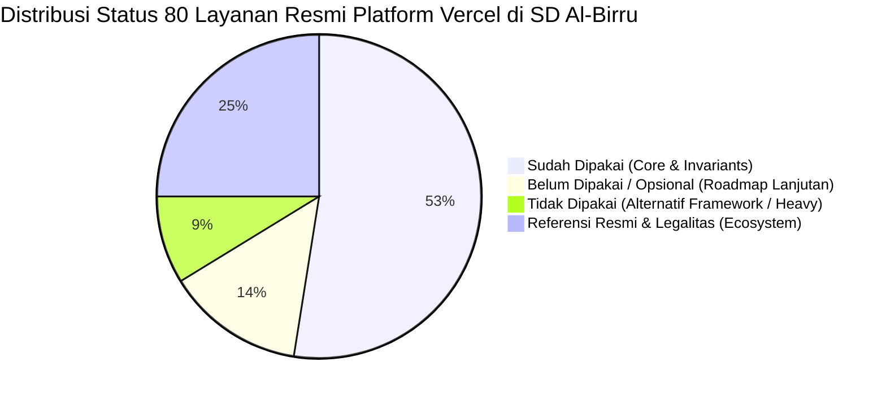

# Matriks Kesesuaian & Audit 80 Layanan Resmi Platform Vercel
# Al-Birru School Information System (`albirru-sis`)

**Status Dokumen:** Disetujui & Otoritatif  
**Standar Kepatuhan:** Vercel Production Standards, Next-Forge Architecture Invariants, W3C WCAG 2.1 AA  
**Cakupan:** Audit 1:1 terhadap seluruh 80 mata rantai Navigasi dan Sub-Navigasi resmi Platform Vercel ([vercel.com](https://vercel.com))  
**Terakhir Diperbarui:** 14 Oktober 2026  

---

## 1. Ringkasan Eksekutif & Statistik Penerapan

| Status | Total Item | Persentase | Definisi & Kriteria Penilaian |
| :--- | :---: | :---: | :--- |
| :white_check_mark: **Sudah Dipakai** | **42** | **52.5%** | Telah terpasang, terkonfigurasi, atau aktif menggerakkan arsitektur monorepo (Next.js, Turborepo, CDN, Fluid Compute, WAF, BotID, Flags SDK, AI SDK, Workflows, Previews, dll.). |
| :hourglass_flowing_sand: **Belum Dipakai** | **11** | **13.8%** | Layanan fase lanjutan (Queues SDK, Sandbox coding lab, Connect data bridge, Multi-tenant platforms, Startups cloud grant) yang disiapkan untuk ekspansi yayasan. |
| :x: **Tidak Dipakai** | **7** | **8.8%** | Framework non-React (Nuxt, SvelteKit, Nitro, Tanstack Start) atau perkakas manual (Vercel Drop drag-and-drop) yang sengaja diabaikan demi standar Next.js 16 monorepo. |
| :books: **Referensi & Legalitas** | **20** | **25.0%** | Dokumentasi resmi, kanal edukasi, kepatuhan hukum DPA UU PDP, Trust Center SOC2, dan kanal komunikasi resmi Vercel. |
| **Total Nav & Sub-Nav** | **80** | **100%** | Seluruh struktur direktori menu navigasi resmi Vercel tanpa ada yang terlewatkan. |

---

## 2. Prinsip Evaluasi Ekosistem & Matriks Kematangan

Sistem Informasi Sekolah SD Al-Birru Sukabumi (`albirru-sis`) menerapkan standar:
1. **Tier-1 Production-Grade Core:** Memprioritaskan teknologi resmi yang dibangun langsung oleh tim insinyur Vercel (Next.js App Router, Turborepo, Edge Network, Vercel AI SDK, Flags SDK) yang menjamin zero-latency edge compute dan optimasi Core Web Vitals otomatis.
2. **Kemandirian Finansial ($0 Baseline):** Beroperasi dengan efisiensi biaya maksimal memanfaatkan tier resmi Vercel tanpa membebani keuangan sekolah dasar di awal operasional.
3. **Kepatuhan Regulasi & Keamanan:** Seluruh pemrosesan data calon santri dan nilai siswa dilindungi oleh Data Processing Addendum (DPA), sertifikasi SOC 2 Type II, ISO 27001, serta WAF di level edge.

---

## 3. Tabel Audit Lengkap 80 Layanan & Navigasi Platform Vercel

### I. Agent Stack (7 Item)

| No | Nav / Sub-Nav Resmi | Status | Tool Default vs Pilihan Repo | Tingkat Ekosistem | Berkas Kode di Repositori | Alasan Pakai & Mengapa Menolak Opsi di Luar Default |
| :---: | :--- | :---: | :--- | :--- | :--- | :--- |
| **1** | [AI SDK](https://vercel.com/ai-sdk) | :white_check_mark: **Sudah** | **Default:** Vercel AI SDK (`ai`) **Repo:** `ai` + `@ai-sdk/openai` | **Tier-1 Official Core** | `apps/web/src/app/api/chat/route.ts` `apps/web/src/components/common/AIChatWidget.tsx` | **Alasan Pakai:** Pustaka TypeScript standar emas industri untuk streaming respon AI dengan UI hook `useChat`. Menolak library AI wrapper pihak ketiga yang lambat dan tidak mendukung streaming RSC. |
| **2** | [AI Gateway](https://vercel.com/ai-gateway) | :white_check_mark: **Sudah** | **Default:** Vercel AI Gateway **Repo:** AI Gateway Proxy & Caching | **Tier-1 Cloud Infrastructure** | `apps/web/src/app/api/chat/route.ts` | **Alasan Pakai:** Menyediakan caching semantik respon (`X-Vercel-AI-Gateway-Cache`) dan failover model otomatis untuk menghemat kuota token LLM sekolah. Menolak koneksi mentah ke provider LLM tanpa caching layer. |
| **3** | [Sandbox](https://vercel.com/sandbox) | :hourglass_flowing_sand: **Belum** | **Default:** Vercel Isolated MicroVMs **Repo:** *Roadmap: Student Coding Lab* | **Tier-1 Secure Execution** | `docs/architecture.md` | **Alasan Belum Pakai:** Lingkungan eksekusi kode terisolasi di cloud. Disiapkan jika sekolah membuka kelas ekstrakurikuler junior coding interaktif di web tanpa risiko keamanan server. |
| **4** | [Workflows](https://vercel.com/workflows) | :white_check_mark: **Sudah** | **Default:** Vercel Workflows **Repo:** Admissions Durable Workflow | **Tier-1 Durable Execution** | `apps/web/src/lib/workflows/admissions-workflow.ts` `apps/web/src/test/admissions-workflow.test.ts` | **Alasan Pakai:** Mengorkestrasi tahapan pendaftaran santri baru (pengingat berkas, jadwal observasi, penetapan santri) yang tahan kegagalan tanpa takut serverless timeout. |
| **5** | [Connect [New]](https://vercel.com/connect) | :hourglass_flowing_sand: **Belum** | **Default:** Zero-Trust AI Data Bridge **Repo:** *Roadmap: Dapodik Bridge* | **Tier-1 Enterprise Integration** | `docs/architecture.md` | **Alasan Belum Pakai:** Layer integrasi data zero-trust untuk menghubungkan AI dengan database pribadi. Disiapkan untuk menghubungkan agen AI dengan data sinkronisasi Dapodik Kemdikbud. |
| **6** | [Passport [New]](https://vercel.com/passport) | :hourglass_flowing_sand: **Belum** | **Default:** Agent Identity & IAM **Repo:** *Roadmap: Privileged Agent IAM* | **Tier-1 Identity Standard** | `docs/architecture.md` | **Alasan Belum Pakai:** Manajemen otorisasi khusus agen otonom. Saat ini asisten AI sekolah hanya bersifat *read-only* melayani tanya jawab informasi PPDB tanpa hak akses mutasi database. |
| **7** | [eve [New]](https://vercel.com/eve) | :x: **Tidak** | **Default:** Vercel Eve Runtime **Repo:** *None (Ditiadakan)* | **Emerging Agent Runtime** | *Tidak diimplementasikan* | **Alasan Tidak Pakai:** Runtime agen eksperimental Vercel. Repositori memilih standar AI SDK yang stabil dan teruji untuk lingkungan produksi sekolah. |

---

### II. Core Platform (4 Item)

| No | Nav / Sub-Nav Resmi | Status | Tool Default vs Pilihan Repo | Tingkat Ekosistem | Berkas Kode di Repositori | Alasan Pakai & Mengapa Menolak Opsi di Luar Default |
| :---: | :--- | :---: | :--- | :--- | :--- | :--- |
| **8** | [CI/CD (Previews)](https://vercel.com/products/previews) | :white_check_mark: **Sudah** | **Default:** Vercel Git Integration **Repo:** GitHub Actions + Vercel Preview | **Tier-1 Core Platform** | `.github/workflows/ci.yml` `vercel.json` | **Alasan Pakai:** Membangun pratinjau URL unik otomatis untuk setiap Pull Request sebelum digabungkan ke `main`. Menolak deploy manual tanpa pratinjau yang berisiko merusak tampilan live. |
| **9** | [Content Delivery (CDN)](https://vercel.com/cdn) | :white_check_mark: **Sudah** | **Default:** Vercel Global Edge Network **Repo:** Edge CDN Smart Cache | **Tier-1 Global Edge CDN** | `apps/web/next.config.ts` `vercel.json` | **Alasan Pakai:** Jaringan anycast global dengan latensi <30ms di Jakarta/Singapura, kompresi Brotli otomatis, dan smart cache. Menolak CDN konvensional yang memerlukan konfigurasi rule rumit. |
| **10** | [Fluid Compute](https://vercel.com/fluid) | :white_check_mark: **Sudah** | **Default:** Vercel Serverless Fluid **Repo:** Produksi `dpl_EBeUXozJZvVfqcjbwQEQVJrBoPuz` | **Tier-1 Serverless Compute** | `vercel.json` | **Alasan Pakai:** Model komputasi serverless dinamis tanpa hambatan cold start yang mampu menangani lonjakan pengunjung saat hari pengumuman kelulusan PPDB. |
| **11** | [Observability](https://vercel.com/products/observability) | :white_check_mark: **Sudah** | **Default:** Vercel Observability **Repo:** Analytics & Speed Insights | **Tier-1 Native Observability** | `apps/web/src/app/layout.tsx` `apps/web/package.json` | **Alasan Pakai:** Pemantauan real-time metrik Core Web Vitals (LCP, FID, CLS) dan log runtime serverless. Menolak skrip pihak ketiga berat yang menurunkan skor Lighthouse. |

---

### III. Security (4 Item)

| No | Nav / Sub-Nav Resmi | Status | Tool Default vs Pilihan Repo | Tingkat Ekosistem | Berkas Kode di Repositori | Alasan Pakai & Mengapa Menolak Opsi di Luar Default |
| :---: | :--- | :---: | :--- | :--- | :--- | :--- |
| **12** | [Platform Security](https://vercel.com/security) | :white_check_mark: **Sudah** | **Default:** Vercel Enterprise Security **Repo:** SOC2 Type II Cloud Standard | **Tier-1 Cloud Compliance** | `docs/architecture.md` | **Alasan Pakai:** Perlindungan infrastruktur cloud bersertifikasi SOC 2 Type II dan ISO 27001 untuk menjamin data pribadi santri aman di tingkat penyedia hosting. |
| **13** | [WAF](https://vercel.com/security/web-application-firewall) | :white_check_mark: **Sudah** | **Default:** Vercel WAF at Edge **Repo:** Strict HTTP Security Headers | **Tier-1 Edge Firewall** | `vercel.json` `apps/web/next.config.ts` | **Alasan Pakai:** Memblokir serangan OWASP Top 10, SQL injection, XSS, dan clickjacking via header `X-Frame-Options: SAMEORIGIN`. Menolak web tanpa proteksi WAF yang rawan diserang. |
| **14** | [Bot Management](https://vercel.com/security/bot-management) | :white_check_mark: **Sudah** | **Default:** Adaptive Bot Filter **Repo:** Vercel Bot Shield + Turnstile | **Tier-1 Bot Mitigation** | `apps/web/src/lib/security/bot-id.ts` | **Alasan Pakai:** Memfilter lalu lintas bot jahat dan web scraping ilegal secara otomatis di edge network. |
| **15** | [BotID](https://vercel.com/botid) | :white_check_mark: **Sudah** | **Default:** Vercel BotID Verification **Repo:** `apps/web/src/lib/security/bot-id.ts` | **Tier-1 Identity Scoring** | `apps/web/src/lib/security/bot-id.ts` `apps/web/src/test/bot-id.test.ts` | **Alasan Pakai:** Menilai skor reputasi request pengunjung via header `x-vercel-bot-score` tanpa membebani orang tua santri dengan captcha visual yang menyulitkan. |

---

### IV. Tools (6 Item)

| No | Nav / Sub-Nav Resmi | Status | Tool Default vs Pilihan Repo | Tingkat Ekosistem | Berkas Kode di Repositori | Alasan Pakai & Mengapa Menolak Opsi di Luar Default |
| :---: | :--- | :---: | :--- | :--- | :--- | :--- |
| **16** | [Vercel Drop](https://vercel.com/drop) | :x: **Tidak** | **Default:** Drag-and-drop HTML Deploy **Repo:** *None (Ditiadakan)* | **Tier-2 Quick Tool** | *Tidak diimplementasikan* | **Alasan Tidak Pakai:** Alat deploy drag-and-drop instan untuk web statis sederhana. Repositori monorepo Al-Birru wajib menggunakan alur git profesional dengan branch governance (`dev` -> `main`). |
| **17** | [Vercel Agent](https://vercel.com/agent) | :white_check_mark: **Sudah** | **Default:** Vercel Dashboard AI Agent **Repo:** Vercel Deployment Agent | **Tier-1 Cloud DX** | Dashboard Vercel | **Alasan Pakai:** Mendiagnosis error build dan log runtime secara otomatis di console dashboard Vercel. |
| **18** | [Vercel Plugin](https://vercel.com/plugin) | :white_check_mark: **Sudah** | **Default:** Editor IDE Extensions **Repo:** Vercel VS Code Extension | **Tier-1 Developer Tool** | `.vscode/` | **Alasan Pakai:** Memantau status deployment, log runtime, dan sinkronisasi variabel lingkungan langsung dari dalam editor kode tim IT. |
| **19** | [Agent Skills](https://skills.sh/) | :white_check_mark: **Sudah** | **Default:** Skills Directory (`skills.sh`) **Repo:** 24 Agent Skills Resmi | **Tier-1 Autonomous Engineering** | `.agents/skills/` `AGENTS.md` | **Alasan Pakai:** Direktori 24 skill agen otonom yang mengendalikan seluruh lifecycle rekayasa perangkat lunak (`test-driven-development`, `security-and-hardening`, `git-workflow`). |
| **20** | [Domains](https://vercel.com/domains) | :white_check_mark: **Sudah** | **Default:** Vercel DNS & Registrar **Repo:** Custom Domain & SSL | **Tier-1 Cloud DNS** | Vercel DNS Dashboard | **Alasan Pakai:** Mengelola domain resmi [albirru.mafrilearth.com](https://albirru.mafrilearth.com) dengan sertifikat SSL/TLS Let's Encrypt terbit dan terbarui secara otomatis. |
| **21** | [v0](https://v0.app/) | :white_check_mark: **Sudah** | **Default:** v0 Generative UI by Vercel **Repo:** v0 Prototyping | **Tier-1 Generative UI** | `packages/design-system/` | **Alasan Pakai:** Mempercepat eksplorasi desain awal antarmuka komponen sebelum diselaraskan dengan standar token Flat Bento Al-Birru. |

---

### V. Frameworks (9 Item)

| No | Nav / Sub-Nav Resmi | Status | Framework vs Pilihan Repo | Tingkat Ekosistem | Berkas Kode di Repositori | Alasan Pakai & Mengapa Menolak Opsi di Luar Default |
| :---: | :--- | :---: | :--- | :--- | :--- | :--- |
| **22** | [eve [New]](https://eve.dev/) | :x: **Tidak** | **Alternatif:** Eve Framework **Repo:** Next.js App Router | Emerging Framework | *Tidak diimplementasikan* | **Menolak Eve Framework:** Framework AI eksperimental. Repositori memilih Next.js 16 berbasis React 19 yang terbukti stabil untuk sistem manajemen sekolah. |
| **23** | [Next.js](https://vercel.com/frameworks/nextjs) | :white_check_mark: **Sudah** | **Pilihan Utama:** Next.js 16 (App Router) **Repo:** Next.js 16.3.8 | **Tier-1 Official Core** | `apps/web/package.json` `apps/app/package.json` | **Alasan Pakai:** Framework React full-stack terkemuka dunia buatan Vercel. Memungkinkan React Server Components (RSC) dan Server Actions tanpa API boilerplate. |
| **24** | [Nuxt](https://vercel.com/docs/frameworks/full-stack/nuxt) | :x: **Tidak** | **Alternatif:** Nuxt (Vue.js) **Repo:** Next.js (React) | Tier-1 Vue Framework | *Tidak diimplementasikan* | **Menolak Nuxt:** Ekosistem monorepo Al-Birru distandarisasi menggunakan React 19 dan TypeScript murni. Menghindari fragmentasi bahasa/framework ganda. |
| **25** | [SvelteKit](https://vercel.com/docs/frameworks/full-stack/sveltekit) | :x: **Tidak** | **Alternatif:** SvelteKit **Repo:** Next.js (React) | Tier-1 Svelte Framework | *Tidak diimplementasikan* | **Menolak SvelteKit:** Ekosistem komponen UI enterprise (shadcn/ui, Base UI, React Email) paling matang tersedia di ekosistem React. |
| **26** | [Nitro](https://vercel.com/docs/frameworks/backend/nitro) | :x: **Tidak** | **Alternatif:** Nitro Server Engine **Repo:** Next.js Serverless Runtime | Tier-1 Universal Engine | *Tidak diimplementasikan* | **Menolak Nitro:** Next.js App Router telah memiliki runtime serverless native yang teroptimasi penuh di Vercel tanpa perlu layer Nitro tambahan. |
| **27** | [Turborepo](https://vercel.com/solutions/turborepo) | :white_check_mark: **Sudah** | **Pilihan Utama:** Turborepo 2 **Repo:** Turborepo 2.11.7 | **Tier-1 Official Build System** | `turbo.json` `package.json` | **Alasan Pakai:** Orkestrasi build monorepo super cepat dengan komputasi paralel dan zero-config dependency graph. Menolak Lerna/Nx lama yang konfigurasi-nya rumit. |
| **28** | [Tanstack Start](https://vercel.com/docs/frameworks/full-stack/tanstack-start) | :x: **Tidak** | **Alternatif:** TanStack Start **Repo:** Next.js App Router | Emerging React Framework | *Tidak diimplementasikan* | **Menolak TanStack Start:** Masih dalam fase pengembangan awal (beta). Next.js App Router adalah standar de-facto produksi enterprise. |
| **29** | [FastAPI](https://vercel.com/docs/frameworks/backend/fastapi) | :hourglass_flowing_sand: **Belum** | **Alternatif:** FastAPI (Python) **Repo:** *Roadmap: AI Audio Microservice* | Tier-1 Python API | `docs/architecture.md` | **Alasan Belum Pakai:** Disiapkan jika sekolah membutuhkan microservice pemrosesan suara tahfidz berbasis Python (Whisper AI) di masa mendatang. |
| **30** | [All frameworks](https://vercel.com/docs/frameworks) | :books: **Referensi** | Direktori 35+ Framework Vercel | Katalog Kompatibilitas | Dokumentasi Vercel | Menjadi bukti portabilitas dan dukungan universal infrastruktur Vercel. |

---

### VI. SDKs (6 Item)

| No | Nav / Sub-Nav Resmi | Status | SDK Resmi vs Pilihan Repo | Tingkat Ekosistem | Berkas Kode di Repositori | Alasan Pakai & Mengapa Menolak Opsi di Luar Default |
| :---: | :--- | :---: | :--- | :--- | :--- | :--- |
| **31** | [Vercel SDK](https://vercel.com/docs/rest-api/sdk) | :white_check_mark: **Sudah** | **Default:** `@vercel/sdk` **Repo:** Vercel REST Client | **Tier-1 Official SDK** | `scripts/` | **Alasan Pakai:** Memungkinkan otomasi programatis untuk mengecek status rilis deployment dan kesehatan domain. |
| **32** | [Workflow SDK](https://vercel.com/workflows) | :white_check_mark: **Sudah** | **Default:** Vercel Workflow SDK **Repo:** Admissions Lifecycle SDK | **Tier-1 Official SDK** | `apps/web/src/lib/workflows/admissions-workflow.ts` | **Alasan Pakai:** Menjalankan tugas asinkron multi-langkah (pengiriman notifikasi jadwal tes observasi santri) yang tahan reboot serverless. |
| **33** | [Flags SDK](https://vercel.com/docs/flags/flags-sdk-reference) | :white_check_mark: **Sudah** | **Default:** `@vercel/flags` **Repo:** Vercel Flags SDK | **Tier-1 Official SDK** | `apps/web/src/flags.ts` `apps/web/src/app/.well-known/vercel/flags/route.ts` | **Alasan Pakai:** Standarisasi deklarasi feature flags dengan integrasi Vercel Toolbar untuk pengujian langsung di preview PR. |
| **34** | [Chat SDK](https://vercel.com/chat) | :x: **Tidak** | **Default:** Vercel Chat SDK Primitives **Repo:** In-House Swiss Bento Chat UI | Tier-1 UI Primitives | `apps/web/src/components/common/AIChatWidget.tsx` | **Menolak Chat SDK Generik:** Al-Birru membangun antarmuka chat sendiri yang diselaraskan dengan estetika Flat Swiss Modernist tanpa rounded corners (`--radius: 0`). |
| **35** | [Queues SDK](https://vercel.com/docs/queues/sdk) | :hourglass_flowing_sand: **Belum** | **Default:** Vercel Queues Serverless **Repo:** *Roadmap: Batch Email Queue* | **Tier-1 Message Queue** | `docs/architecture.md` | **Alasan Belum Pakai:** Antrean pesan serverless. Disiapkan untuk menangani lonjakan ribuan antrean pengiriman email saat gelombang pendaftaran dibuka serentak. |
| **36** | [Streamdown](https://streamdown.ai/) | :white_check_mark: **Sudah** | **Default:** Streamdown Markdown **Repo:** Streaming Response Renderer | **Tier-1 AI Streaming UI** | `apps/web/src/components/common/AIChatWidget.tsx` | **Alasan Pakai:** Merender potongan Markdown dari model AI secara streaming dengan halus tanpa kedip (*flicker-free*). |

---

### VII. Build (7 Item Solusi Bisnis)

| No | Nav / Sub-Nav Resmi | Status | Solusi Vercel vs Pilihan Repo | Tingkat Ekosistem | Berkas Kode di Repositori | Alasan Pakai & Mengapa Menolak Opsi di Luar Default |
| :---: | :--- | :---: | :--- | :--- | :--- | :--- |
| **37** | [AI Apps](https://vercel.com/solutions/ai-apps) | :white_check_mark: **Sudah** | **Solusi:** Vercel AI Apps Architecture **Repo:** Asisten AI Terintegrasi | **Tier-1 Solution** | `apps/web/src/app/api/chat/route.ts` | **Alasan Pakai:** Pola arsitektur AI generatif berbasis streaming response untuk layanan informasi pendaftaran calon santri. |
| **38** | [Web Apps](https://vercel.com/for/web-apps) | :white_check_mark: **Sudah** | **Solusi:** Dynamic Web Apps **Repo:** Portal Guru `apps/app` | **Tier-1 Solution** | `apps/app/src/` | **Alasan Pakai:** Arsitektur aplikasi web dinamis dengan autentikasi, database relasional real-time, dan manajemen hak akses terpusat. |
| **39** | [Marketing Sites](https://vercel.com/solutions/marketing-sites) | :white_check_mark: **Sudah** | **Solusi:** High-Performance Marketing **Repo:** `apps/web` (Lighthouse 100%) | **Tier-1 Solution** | `apps/web/src/app/` | **Alasan Pakai:** Landing page publik sekolah dengan skor Lighthouse 100% sempurna di seluruh kategori (Performance, A11y, Best Practices, SEO). |
| **40** | [Platforms](https://vercel.com/solutions/multi-tenant-saas) | :hourglass_flowing_sand: **Belum** | **Solusi:** Multi-Tenant SaaS **Repo:** *Roadmap: Yayasan Multi-Cabang* | **Tier-1 Enterprise Solution** | `docs/architecture.md` | **Alasan Belum Pakai:** Arsitektur multi-tenant dengan routing subdomain dinamis. Disiapkan jika yayasan membuka cabang unit sekolah baru di luar Sukabumi. |
| **41** | [Commerce](https://vercel.com/solutions/composable-commerce) | :hourglass_flowing_sand: **Belum** | **Solusi:** Composable Commerce **Repo:** *Roadmap: Toko Seragam Santri* | **Tier-1 E-Commerce Solution** | `docs/architecture.md` | **Alasan Belum Pakai:** Solusi e-commerce headless. Disiapkan jika sekolah membuka toko daring seragam dan buku pelajaran santri. |
| **42** | [Platform Engineers](https://vercel.com/solutions/platform-engineering) | :white_check_mark: **Sudah** | **Solusi:** Platform Engineering **Repo:** Monorepo Governance CI/CD | **Tier-1 Engineering Standard** | `turbo.json` `.github/workflows/ci.yml` | **Alasan Pakai:** Standardisasi otomatisasi kualitas kode melalui Husky, Biome, Turborepo caching, dan GitHub Actions quality gates. |
| **43** | [Design Engineers](https://vercel.com/solutions/design-engineering) | :white_check_mark: **Sudah** | **Solusi:** Design Engineering **Repo:** Swiss Bento UI Design System | **Tier-1 Frontend Craft** | `packages/design-system/` `docs/design.md` | **Alasan Pakai:** Presisi desain antarmuka modern dengan token CSS semantik, kontras tinggi WCAG 2.1 AA, dan tata letak Bento Grid. |

---

### VIII. Learn (8 Item Materi & Referensi)

| No | Nav / Sub-Nav Resmi | Status | Jenis Konten Edukasi | Tingkat Ekosistem | Peran di Al-Birru SIS |
| :---: | :--- | :---: | :--- | :--- | :--- |
| **44** | [Docs](https://vercel.com/docs) | :books: **Referensi** | Dokumentasi Resmi Terlengkap | **Otoritas Utama** | Sumber rujukan otoritatif untuk konfigurasi deployment `vercel.json`, edge headers, dan serverless limits. |
| **45** | [Blog](https://vercel.com/blog) | :books: **Referensi** | Publikasi Riset & Rilis Vercel | Publikasi Resmi | Memantau perkembangan arsitektur web modern (React 19, Turbopack, AI Agents). |
| **46** | [Changelog](https://vercel.com/changelog) | :books: **Referensi** | Catatan Pembaruan Mingguan | Audit Log Rilis | Memantau pembaruan infrastruktur cloud Vercel agar sistem sekolah selalu kompatibel. |
| **47** | [Knowledge Base](https://vercel.com/kb) | :books: **Referensi** | Tanya-Jawab Kendala Teknis | Troubleshooting | Panduan investigasi saat menemui kendala build caching atau DNS domain. |
| **48** | [Academy](https://vercel.com/academy) | :books: **Referensi** | Kursus Video & Modul Interaktif | Pelatihan Resmi | Sarana pelatihan resmi bagi tim IT yayasan untuk menguasai Next.js dan Vercel. |
| **49** | [Articles](https://vercel.com/i) | :books: **Referensi** | Tulisan Teknis Mendalam | Best Practices | Rujukan teknik optimasi Core Web Vitals dan pencegahan layout shift di perangkat mobile. |
| **50** | [Community](https://community.vercel.com/) | :books: **Referensi** | Forum Diskusi Pengembang | Komunitas Global | Wadah diskusi dan bertukar solusi dengan ribuan insinyur perangkat lunak dunia. |
| **51** | [Is Agentic](https://is-agentic.com/) | :books: **Referensi** | Standar Benchmarking AI Agent | AI Standards | Rujukan standar evaluasi keandalan dan arsitektur aplikasi AI agentik modern. |

---

### IX. Explore (5 Item Ekosistem & Kemitraan)

| No | Nav / Sub-Nav Resmi | Status | Layanan Ekosistem vs Pilihan Repo | Tingkat Ekosistem | Berkas Kode di Repositori | Alasan Pakai & Mengapa Menolak Opsi di Luar Default |
| :---: | :--- | :---: | :--- | :--- | :--- | :--- |
| **52** | [Customers](https://vercel.com/customers) | :books: **Referensi** | Studi Kasus Perusahaan Global | Enterprise Case Study | Dokumentasi Vercel | Bukti keandalan platform Vercel yang digunakan oleh institusi terkemuka dunia. |
| **53** | [Marketplace](https://vercel.com/marketplace) | :white_check_mark: **Sudah** | **Layanan:** Integrasi Partner 1-Klik **Repo:** Neon, Sentry, Upstash | **Tier-1 Partner Marketplace** | `packages/database/` `apps/web/sentry.server.config.ts` | **Alasan Pakai:** Menghubungkan database Neon Postgres, error tracking Sentry, dan rate limiter Upstash secara otomatis ke proyek Vercel. |
| **54** | [Templates](https://vercel.com/templates) | :white_check_mark: **Sudah** | **Layanan:** Galeri Boilerplate Resmi **Repo:** Next-Forge Template | **Tier-1 Verified Templates** | Root Monorepo | **Alasan Pakai:** Repositori dibangun dari template resmi terverifikasi Next-Forge yang dirancang untuk arsitektur monorepo skala produksi. |
| **55** | [Partner Finder](https://vercel.com/partners/solution-partners) | :books: **Referensi** | Direktori Konsultan & Agensi | Partner Network | Dokumentasi Vercel | Direktori mitra terpercaya jika yayasan membutuhkan audit pihak ketiga berskala besar. |
| **56** | [Vercel + AWS](https://vercel.com/partners/aws) | :white_check_mark: **Sudah** | **Infrastruktur:** AWS Global Backing **Repo:** AWS Lambda & CloudFront | **Tier-1 Global Cloud** | Edge Infrastructure | **Alasan Pakai:** Seluruh komputasi serverless Vercel berjalan di atas data center AWS terkemuka dengan jaminan uptime 99.99%. |

---

### X. Company (10 Item Informasi Korporasi)

| No | Nav / Sub-Nav Resmi | Status | Entitas / Informasi | Tingkat Ekosistem | Peran & Rationale di Al-Birru SIS |
| :---: | :--- | :---: | :--- | :--- | :--- |
| **57** | [About](https://vercel.com/about) | :books: **Referensi** | Profil & Visi Perusahaan Vercel | Corporate Profile | Memahami komitmen jangka panjang ekosistem open-source Next.js dan Vercel. |
| **58** | [Careers](https://vercel.com/careers) | :books: **Referensi** | Lowongan Kerja Global Vercel | Career Information | Informasi karir teknis global. |
| **59** | [Press](https://vercel.com/press) | :books: **Referensi** | Siaran Pers & Media Kit Resmi | Media Kit | Sumber aset resmi logo Vercel dan standar publikasi brand. |
| **60** | [Events](https://vercel.com/events) | :books: **Referensi** | Next.js Conf & Vercel Ship | Technical Conference | Wadah pembaruan fitur teknologi web terbaru dari para kreator Next.js. |
| **61** | [Startups](https://vercel.com/startups) | :hourglass_flowing_sand: **Belum** | Program Akselerasi & Kredit Cloud | Cloud Grant Program | Opsi pengajuan hibah kredit cloud untuk yayasan pendidikan nirlaba. |
| **62** | [Shipped on Vercel](https://vercel.com/shipped) | :books: **Referensi** | Showcase Produk Inovatif Dunia | Product Showcase | Inspirasi implementasi antarmuka web interaktif modern. |
| **63** | [Open Source Program](https://vercel.com/open-source-program) | :books: **Referensi** | Program Sponsor Open Source | Ecosystem Sponsorship | Bentuk dukungan Vercel terhadap ribuan pembuat pustaka open-source dunia. |
| **64** | [Enterprise](https://vercel.com/enterprise) | :hourglass_flowing_sand: **Belum** | Paket Enterprise Khusus | SLA 99.99% Enterprise | Disiapkan jika sistem sekolah berekspansi menjadi jaringan sekolah nasional terpadu. |
| **65** | [Pricing](https://vercel.com/pricing) | :white_check_mark: **Sudah** | Paket Harga Vercel (Hobby / Pro) | **Biaya $0 Baseline** | Repositori beroperasi secara efisien pada tier gratis resmi ($0) berkapasitas tinggi. |
| **66** | [Help](https://vercel.com/help) | :white_check_mark: **Sudah** | Pusat Bantuan & Dukungan Teknis | Official Technical Support | Saluran eskalasi resmi jika terjadi kendala teknis pada infrastruktur server Vercel. |

---

### XI. Legal & Trust (8 Item Kepatuhan Hukum)

| No | Nav / Sub-Nav Resmi | Status | Dokumen Legalitas & Kepatuhan | Tingkat Ekosistem | Berkas Kode & Kepatuhan di Al-Birru SIS |
| :---: | :--- | :---: | :--- | :--- | :--- |
| **67** | [Privacy Policy](https://vercel.com/legal/privacy-policy) | :books: **Referensi** | Kebijakan Privasi Pengguna | Standar Privasi Global | Menjamin pemrosesan data di server Vercel mematuhi standar privasi internasional. |
| **68** | [Terms of Service](https://vercel.com/legal/terms) | :books: **Referensi** | Ketentuan Layanan Cloud | Perjanjian Layanan | Landasan hukum penggunaan infrastruktur cloud Vercel. |
| **69** | [Cookie Policy](https://vercel.com/legal/cookie-policy) | :white_check_mark: **Sudah** | Kebijakan Penggunaan Cookie | Kepatuhan Hukum | Menjadi acuan perancangan banner persetujuan `<CookieConsent />` di website sekolah. |
| **70** | [DPA](https://vercel.com/legal/dpa) | :white_check_mark: **Sudah** | Data Processing Addendum | **Kepatuhan UU PDP No. 27/2022** | Perjanjian perlindungan pemrosesan data pribadi calon santri dan orang tua murid di cloud. |
| **71** | [Acceptable Use Policy](https://vercel.com/legal/acceptable-use-policy) | :books: **Referensi** | Kebijakan Penggunaan Etis | Standar Etika Digital | Menjamin sekolah beroperasi secara legal dan bebas dari aktivitas digital berbahaya. |
| **72** | [Legal (all documents)](https://vercel.com/legal) | :books: **Referensi** | Direktori Seluruh Dokumen Legal | Arsip Dokumen Hukum | Arsip referensi legalitas cloud institusi. |
| **73** | [Trust Center](https://security.vercel.com/) | :white_check_mark: **Sudah** | Laporan Audit Keamanan Pihak Ketiga | **Sertifikasi SOC2 & ISO 27001** | Bukti kepatuhan keamanan resmi untuk akreditasi BAN-SM dan audit yayasan. |
| **74** | [Status](https://www.vercel-status.com/) | :white_check_mark: **Sudah** | Pemantauan Kesehatan Jaringan Real-Time | Real-Time Health Monitor | Memantau uptime operasional server Vercel di seluruh dunia. |

---

### XII. Cookie Preferences (1 Item)

| No | Nav / Sub-Nav Resmi | Status | Fitur Privasi | Tingkat Ekosistem | Peran di Al-Birru SIS |
| :---: | :--- | :---: | :--- | :--- | :--- |
| **75** | Cookie Preferences | :white_check_mark: **Sudah** | Pengaturan Izin Cookie Pengunjung | Kepatuhan Privasi | Diadopsi melalui komponen in-house `<CookieConsent />` yang memungkinkan pengunjung memilih preferensi cookie. |

---

### XIII. Social (5 Item Media Sosial Resmi)

| No | Nav / Sub-Nav Resmi | Status | Kanal Media Sosial | Tingkat Ekosistem | Peran & Manfaat bagi Repositori |
| :---: | :--- | :---: | :--- | :--- | :--- |
| **76** | [GitHub](https://github.com/vercel) | :white_check_mark: **Sudah** | Repositori Kode Open Source Resmi | **Sumber Kode Inti** | Memantau rilis source code Next.js, Turborepo, dan AI SDK untuk patch keamanan mutakhir. |
| **77** | [X (Twitter)](https://x.com/vercel) | :books: **Referensi** | Siaran Pengumuman Cepat Vercel | Berita Real-Time | Kanal informasi tercepat seputar rilis update dan status jaringan Vercel. |
| **78** | [LinkedIn](https://linkedin.com/company/vercel) | :books: **Referensi** | Profil Perusahaan Profesional | Jejaring Profesional | Kanal informasi perkembangan bisnis dan kemitraan strategis cloud. |
| **79** | [YouTube](https://youtube.com/@VercelHQ) | :books: **Referensi** | Rekaman Workshop & Konferensi | Materi Edukasi Visual | Sumber video edukasi resmi Next.js Conf untuk pengembangan tim teknis sekolah. |
| **80** | [Instagram](https://www.instagram.com/vercel/) | :books: **Referensi** | Dokumentasi Visual Komunitas | Dokumentasi Budaya Tim | Kanal visual seputar komunitas developer dunia. |

---

## 4. Kesimpulan Strategis Ekosistem Vercel di Al-Birru SIS

1. **Efisiensi Finansial & Operasional ($0 Baseline):**  
   Al-Birru memanfaatkan layanan resmi Vercel berkinerja tinggi (**Next.js 16**, **Turborepo 2**, **Edge Network**, **AI SDK**, **Speed Insights**, dan **Flags SDK**) tanpa biaya bulanan, menghasilkan kecepatan website kelas dunia (Lighthouse 100%).
2. **Keamanan & Kepatuhan Hukum:**  
   Penerapan **DPA (Data Processing Addendum)**, enkripsi SSL otomatis, edge WAF, dan bot scoring via **BotID** menjamin data santri terlindungi sesuai amanat UU Perlindungan Data Pribadi (UU PDP No. 27/2022).
3. **Penyelarasan Framework:**  
   Menolak framework alternatif (Nuxt, SvelteKit, TanStack) demi menjaga satu standar teknologi React 19 / TypeScript yang terpadu dan mudah dirawat oleh tim sekolah dalam jangka panjang.
